<p align="center">
  <picture>
    <source media="(prefers-color-scheme: dark)" srcset="assets/hero-dark.svg">
    <source media="(prefers-color-scheme: light)" srcset="assets/hero-light.svg">
    
  </picture>
</p>

<p align="center">
  <a href="https://github.com/Aboudjem/goalify/actions/workflows/validate.yml"></a>
  <a href="LICENSE"></a>
  <a href="https://github.com/Aboudjem/goalify/releases"></a>
  <a href="https://github.com/Aboudjem/goalify/stargazers"></a>
</p>

<p align="center">
  <b>English</b> · <a href="READMEs/zh-CN.md">简体中文</a> · <a href="READMEs/ja.md">日本語</a> · <a href="READMEs/es.md">Español</a> · <a href="READMEs/fr.md">Français</a>
</p>

<p align="center">
  <strong>Give your AI a big job. Get proof back.</strong>
</p>

<p align="center">
  <a href="https://goalify-kappa.vercel.app">Website</a> · <a href="#install">Install</a> · <a href="#how-it-works">How it works</a> · <a href="#new-in-30">New in 3.0</a> · <a href="#how-it-compares">How it compares</a> · <a href="#good-to-know">Good to know</a>
</p>

goalify turns your request into a **goal**. A goal is a clear finish line. The AI keeps working
until the goal is done and proven, or until it reaches the limit you set.

goalify does the thinking first. It checks that the plan can work. It reads the docs. It finds the
real tests in your project. It asks you all its questions at the start, one time. Then the AI
works alone, for hours or even days, and nobody needs to answer anything. At the end, it shows
you proof.

It works best in **Claude Code** and **Codex**. Both have a built-in `/goal` command that keeps
the work going. In Claude Code, a second checker reads the work after every step. Codex checks
its own work against the same finish line. goalify also installs in 70+ other AI tools. There you
get the same plan and finish line, and you start the work yourself.

## Install

```bash
claude plugin marketplace add Aboudjem/10x
claude plugin install goalify@10x
```

Any other AI tool that reads skills, in one line:

```bash
npx skills add Aboudjem/goalify
```

Then type `/goalify` and describe the job. You need Claude Code 2.1.139 or newer. That version
added `/goal`.

<p align="center">
  <a href="https://goalify-kappa.vercel.app"></a>
  <br><sub><a href="assets/goalify-promo.mp4">Watch the full video</a> · <a href="assets/goalify-promo-vertical.mp4">vertical video</a> · <a href="assets/goalify-promo-30s.mp4">30-second video</a> · <a href="assets/goalify-promo-15s.mp4">15-second video</a></sub>
</p>

## Without goalify, with goalify

| Without goalify | With goalify |
|:--|:--|
| The AI stops at 3am to ask you a question | All questions come first, one time |
| The plan is lost when you clear the chat | The plan is saved in a file. The AI reads it again and again |
| The AI uses a test that your project does not have | The tests come from your real project |
| "Done!" only means the AI said so | "Done" means the last step shows the tests passing |
| You find the problems the next morning | `/goalify verify` runs the tests again and gives you a receipt |

## How it works

goalify only prepares the work. The `/goal` command does the work. goalify makes sure the AI has
nothing left to ask.

1. **Homework.** Can this work? goalify reads your project, the docs and your tests. It finds the
   commands that show the job is really done.
2. **Questions, one time.** It asks you the few real choices, all together. After that, it does
   not ask again.
3. **Two things come out.** The **brief** is a file with the full plan: your choices, the exact
   files, the order of the work. The **condition** is one line for `/goal`. It says what proof
   looks like. A **preview page** also opens, so you can see the whole plan first.
4. **`/clear`, paste, walk away.** The work starts in a clean chat, with all its memory free for
   your job. In Claude Code, a second checker reads the work after every step. It lets the work
   stop only when the proof is there, or when it reaches your step limit.
5. **Check it later.** `/goalify verify` runs the checks again and writes a receipt.

The line you paste looks like this. It is long, so copy all of it:

```text
/goal Do everything in ~/acme/.goal/api-migration.md and prove it, done when the last turn quotes npm test passing and says ASYNC-OK. Stop after 40 turns.
```

The path to the brief is inside that line. This matters: the checker behind `/goal` cannot open
files. It only reads the line you paste and the chat. So do not give `/goal` only a file path.
Nothing breaks, but nothing is checked either. It is the easiest mistake to make:

```text v1-antipattern
/goal ~/acme/.goal/api-migration.md
```

<p align="center">
  
</p>

### Why it can work for days

Long AI work usually fails in two ways. The AI stops to ask you something. Or it says "done" when
something is still broken. goalify fixes the first problem: it asks everything at the start and
writes the answers in the brief. It fixes the second problem with the condition: at the end, the
AI must run every check again, show the result, and write a special word like `ASYNC-OK`. If the
AI skipped the work, it would have to lie. Near its step limit, the AI finishes cleanly and says
what is left. If it stops early, the brief keeps its checklist. Paste the same line again to
continue.

## New in 3.0

<p align="center">
  
</p>

- **Plan preview.** After every `/goalify`, a page opens in your browser. It shows the steps, each
  check and the command that proves it, the limits, your choices, and a copy button for the
  `/goal` line. It also checks the brief and refuses to show a broken one. The `/goal` line in
  the chat is still the main step. The page is extra.
- **Proof receipts.** `/goalify verify` shows you the checks, asks you one time, runs them, and
  writes a receipt: **VERIFIED**, **NOT VERIFIED** or **UNVERIFIABLE**. It can say "not verified"
  even when the AI said "done". It will not run dangerous commands unless you allow each one.
- **Real tests, found for you.** goalify reads `package.json`, `pyproject.toml`, `Cargo.toml`,
  `go.mod`, Makefiles and your CI files. It skips npm's empty "no test specified" test. So the
  finish line never uses a test that cannot pass. It can also run the tests once at the start.
- **Status.** `/goalify status` lists every brief in `.goal/`: open, blocked or done. For each open
  one, it shows the full `/goal` line to continue.
- **Quick mode.** `/goalify --quick <task>` is for medium jobs. It skips the web research and the
  questions, but keeps every safety check. If the job could mean two different things, it stops
  and asks you to use the full mode.
- **Doctor.** `/goalify doctor` lists every copy of goalify on your computer. It warns you when an
  old copy is loaded next to the new one.
- **Safer copy and paste.** The condition cannot contain backticks or double quotes anymore. So
  the `claude -p "/goal ..."` line cannot run a hidden command when you paste it. Thanks to
  [@Hug0x0](https://github.com/Hug0x0) for this fix.

## How it compares

Simple differences, checked against each project's README in November 2026.

| Tool | What it is | How it is different from goalify |
|:--|:--|:--|
| [supergoal](https://github.com/robzilla1738/supergoal) | A Claude Code plugin. It explores, asks, plans in phases and gives `/goal` one command. It checks the result against the plan at the end | The closest tool. goalify writes one full brief and a checked condition, shows a preview page before the work, and writes a proof receipt after |
| Ralph loops ([snarktank/ralph](https://github.com/snarktank/ralph) and others) | A loop that gives the AI the same prompt again and again | It usually stops on a word the AI writes, or after a number of rounds. With Claude Code's `/goal`, a second checker reads the work every step |
| [Spec Kit](https://github.com/github/spec-kit) | GitHub's toolkit to write a spec, a plan and tasks | Great for writing the spec. goalify is for the long work with nobody watching, and for proving it is finished |

## Works in your AI tool

| Tool | One-line install |
|:--|:--|
| Claude Code | `claude plugin install goalify@10x` |
| Any of 70+ AI tools | `npx skills add Aboudjem/goalify` |
| Cursor, Codex, Copilot, Gemini CLI, OpenCode | `npx skills add Aboudjem/goalify -a <agent>` |
| Everything else | the codes and folders in [docs/editors.md](docs/editors.md) |

`/clear` and `/goal` are Claude Code commands. In other tools, start a new chat instead of `/clear`,
and give the AI the condition as its main task. Codex has its own `/goal`. See
[goalify in Codex](docs/codex.md) for what works the same and what does not.

<details>
<summary>Install by hand</summary>

```bash
git clone https://github.com/Aboudjem/goalify
cp -R goalify/skills/goalify ~/.claude/skills/
```

You only need that one folder. The [quickstart](docs/quickstart.md) explains the rest. If you
had an older copy, run `/goalify doctor` to make sure only one copy is loaded.
</details>

## Good to know

> [!IMPORTANT]
> When a run stops, it is not always finished. The checker decides by itself. It can also stop
> the run if it thinks the goal cannot be reached. Before you trust a green result, run
> `/goalify verify` on the brief, or run its checks yourself.

- **goalify never does the job itself.** It writes the brief and the condition. It runs your
  checks only when you ask.
- **Nothing is sent anywhere.** No server, no extra packages, no network calls. The helper
  scripts use only standard Python, and the preview page loads nothing from the internet.
- **No price guesses.** goalify never guesses a cost in money or tokens. Your step limit is your
  control.
- **Everything it does not promise** is listed in [honest limits](docs/limits.md).

## Learn more

- [Website](https://goalify-kappa.vercel.app) · [Quickstart](docs/quickstart.md) · [FAQ](docs/faq.md)
- [Example conditions](examples/conditions.md): good ones and bad ones, and what each bad one loses.
- [A full example](examples/sample-brief.md): a real brief and its condition, plus
  [its preview page](examples/sample-brief.html) (download it and open it in a browser).
- [Install in your AI tool](docs/editors.md) · [goalify in Codex](docs/codex.md) · [Honest limits](docs/limits.md)
- [Changelog](CHANGELOG.md) · [The skill itself](skills/goalify/SKILL.md) · [LICENSE](LICENSE)

---

<sub>Made by <a href="https://github.com/Aboudjem">Adam Boudjemaa</a>. MIT license. `/goal` facts
checked against Claude Code 2.1.317 and its docs, November 2026.
<a href="https://github.com/Aboudjem/goalify/issues">See a problem?</a></sub>
