<p align="center">
  <picture>
    <source media="(prefers-color-scheme: dark)" srcset="assets/hero-dark.svg">
    <source media="(prefers-color-scheme: light)" srcset="assets/hero-light.svg">
    
  </picture>
</p>

<p align="center">
  <a href="https://github.com/Aboudjem/goalify/actions/workflows/validate.yml"></a>
  <a href="LICENSE"></a>
  <a href="https://github.com/Aboudjem/goalify/releases"></a>
</p>

<p align="center">
  <b>English</b> · <a href="READMEs/zh-CN.md">简体中文</a> · <a href="READMEs/ja.md">日本語</a> · <a href="READMEs/es.md">Español</a> · <a href="READMEs/fr.md">Français</a>
</p>

<p align="center">
  <strong>Give your agent a big job and get proof back.</strong>
</p>

<p align="center">
  <a href="https://goalify-kappa.vercel.app">Website</a> · <a href="#install">Install</a> · <a href="#how-it-works">How it works</a> · <a href="#sample-report">Sample report</a> · <a href="#proof">Proof</a> · <a href="#faq">FAQ</a> · <a href="#limits">Limits</a>
</p>

goalify asks its questions first, writes the plan, and re-runs your tests on request.

| Questions asked once | Plan saved to file | Proof it is done |
|:--|:--|:--|
| Every question comes first, once. The answers sit in the brief under "Decisions". | The run re-reads the brief file, so it can start in a clean chat. | `/goalify verify` re-runs your tests: `make demo` VERIFIED, `--broken` NOT VERIFIED. |

**Works with:** any agent that reads skills, and not tied to one model (plain Markdown and Python). Tested in Claude Code and Codex CLI, which both have `/goal`.

```bash
npx skills add Aboudjem/goalify -g
# then, in your agent: /goalify migrate the API client to async
```

The demo receipt, from `make demo` in a clone of this repo (a real run on 2026-11-17, trimmed):

```text
VERDICT: VERIFIED (2/2 checks passed)
Checks:
  1. PASS (exit 0) python3 -m unittest -q test_slugify
  2. PASS (printed nothing, as expected) grep -n "TODO" slugify.py
```

**What it is:** a skill that turns a big job into a plan file and one `/goal` line.
**When to use it:** for a job too big for one chat, like a migration.
**What you get:** a run with no questions left for you, and a receipt from your own tests.

A stopped run is not always done, and it can pause on a permission prompt ([Limits](#limits)).

## Without goalify, with goalify

| Without goalify | With goalify |
|:--|:--|
| The AI stops at 3am to ask you a question | All questions come first, one time |
| The plan is lost when you clear the chat | The plan is saved in a file. The AI reads it again and again |
| The AI uses a test that your project does not have | The tests come from your real project |
| "Done!" only means the AI said so | "Done" means the last step shows the tests passing |
| You find the problems the next morning | `/goalify verify` runs the tests again and gives you a receipt |

## Install

**Recommended: the Vercel skills CLI.** One command, for all your projects:

```bash
npx skills add Aboudjem/goalify -g
```

Works in more than 70 agents: pick yours in the menu ([supported agents](https://github.com/vercel-labs/skills#supported-agents)). `npx skills` is Vercel's open
installer for agent skills. <a href="https://skills.sh/aboudjem/goalify"></a> [skills.sh/aboudjem/goalify](https://skills.sh/aboudjem/goalify)

Only this project: drop `-g`.

In a terminal it shows the agent menu. In a script it installs into every agent folder, so add `-a <agent>` there.

**Or install straight into one agent.** Each command installs goalify for all your projects.

<p align="center">
  <a href="#install-claude-code"></a>
  <a href="#install-codex"></a>
  <a href="#install-cursor"></a>
  <a href="#install-gemini-cli"></a>
  <a href="#install-github-copilot"></a>
  <a href="#install-opencode"></a>
</p>

<a id="install-claude-code"></a>**Claude Code**, tested:

```bash
npx skills add Aboudjem/goalify -g -a claude-code
```

<a id="install-codex"></a>**Codex**, tested:

```bash
npx skills add Aboudjem/goalify -g -a codex
```

<a id="install-cursor"></a>**Cursor**, install tested:

```bash
npx skills add Aboudjem/goalify -g -a cursor
```

<a id="install-gemini-cli"></a>**Gemini CLI**, install tested:

```bash
npx skills add Aboudjem/goalify -g -a gemini-cli
```

<a id="install-github-copilot"></a>**GitHub Copilot**, install tested:

```bash
npx skills add Aboudjem/goalify -g -a github-copilot
```

<a id="install-opencode"></a>**OpenCode**, install tested:

```bash
npx skills add Aboudjem/goalify -g -a opencode
```

Another agent: see its `-a` code in [docs/editors.md](docs/editors.md).

**Or as a Claude Code plugin**, tested. Same skill, managed by Claude Code's plugin system:

```bash
claude plugin marketplace add Aboudjem/10x && claude plugin install goalify@10x
```

The skills CLI shows a medium risk warning for goalify, because `verify` runs the brief's check
commands in a shell. verify lists those commands first and runs nothing without your yes.

You need Claude Code 2.1.139 or newer for `/goal`.

**Your first command.** Type `/goalify` and the job in one sentence:

```text
/goalify migrate the API client to async and keep every test green
```

goalify asks its questions. Then it prints a brief path and one `/goal` line to paste.

**See a real receipt in one minute**, without a long run. You need `git`, `python3` and `make`.

```bash
git clone https://github.com/Aboudjem/goalify && cd goalify
```

```bash
make demo
```

<p align="center">
  <a href="https://goalify-kappa.vercel.app"></a>
  <br><sub>An animation of the flow, not a screen recording.</sub>
  <br><sub><a href="assets/goalify-promo.mp4">Watch the full video</a> · <a href="assets/goalify-promo-vertical.mp4">vertical video</a> · <a href="assets/goalify-promo-30s.mp4">30-second video</a> · <a href="assets/goalify-promo-15s.mp4">15-second video</a></sub>
</p>

## How it works

goalify prepares the work, and `/goal` does it. goalify turns your request into a **goal**: a clear
end point that your own tests can check.

1. **Research.** Can this work? goalify reads your project, the docs and your tests. It finds the
   commands that show the job is really done.
2. **Questions, one time.** It asks you the few real choices, all together. After that, it does
   not ask again.
3. **Two things come out.** The **brief** is a file with the full plan: your choices, the exact
   files, the order of the work. The **condition** is one line for `/goal`. It says what proof
   looks like. A **preview page** also opens, so you can see the whole plan first.
4. **`/clear`, paste, and leave it.** The work starts in a clean chat, with all its memory free
   for your job. In Claude Code, a second checker reads the work after every step. It lets the
   work stop only when the proof is there, or when it reaches your step limit.
5. **Check it later.** `/goalify verify` runs the checks again and writes a receipt.

It works best in **Claude Code** and **Codex**, because both have a built-in `/goal`. Codex checks
its own work against the same goal. In other agents, you start the work yourself from the same plan.

The line you paste looks like this. It is long, so copy all of it:

```text
/goal Do everything in ~/acme/.goal/api-migration.md and prove it, done when the last turn quotes npm test passing and says ASYNC-OK. Stop after 40 turns.
```

The path to the brief is inside that line. This matters: the checker behind `/goal` cannot open
files. It only reads the line you paste and the chat. So do not give `/goal` only a file path.
Nothing breaks, but nothing is checked either. It is the easiest mistake to make:

```text v1-antipattern
/goal ~/acme/.goal/api-migration.md
```

<p align="center">
  
</p>

### Why a long run does not get lost

The brief holds every answer, and the condition demands proof. Long AI work usually fails in two
ways: the AI stops to ask you something, or it says "done" when something is still broken.

1. **No questions mid-run.** goalify asks everything at the start and writes the answers in the brief.
2. **No false "done".** At the end, the AI must run every check again, show the result, and write a
   special word like `ASYNC-OK`. If it skipped the work, it would have to lie.
3. **No lost work.** Near its step limit, the AI ends cleanly and says what is left. If it stops early,
   the brief keeps its checklist. Paste the same line again to continue.

### What each command gives you

<p align="center">
  
</p>

- **Plan preview.** After every `/goalify`, a page opens in your browser. It shows the steps, each
  check and the command that proves it, the limits, your choices, and a copy button for the
  `/goal` line. It also checks the brief and refuses to show a broken one. The `/goal` line in
  the chat is still the main step. The page is extra.
- **Proof receipts.** `/goalify verify` shows you the checks, asks you one time, runs them, and
  writes a receipt: **VERIFIED**, **NOT VERIFIED** or **UNVERIFIABLE**. It can say "not verified"
  even when the AI said "done". It will not run dangerous commands unless you allow each one.
- **Real tests, found for you.** goalify reads `package.json`, `pyproject.toml`, `Cargo.toml`,
  `go.mod`, Makefiles and your CI files. It skips npm's empty "no test specified" test. So the
  goal never uses a test that cannot pass. It can also run the tests once at the start.
- **Status.** `/goalify status` lists every brief in `.goal/`: open, blocked or done. For each open
  one, it shows the full `/goal` line to continue.
- **Quick mode.** `/goalify --quick <task>` is for medium jobs. It skips the web research and the
  questions, but keeps every safety check. If the job could mean two different things, it stops
  and asks you to use the full mode.
- **Doctor.** `/goalify doctor` lists every copy of goalify on your computer. It warns you when an
  old copy is loaded next to the new one.
- **Safer copy and paste.** The condition never contains backticks or double quotes. So
  the `claude -p "/goal ..."` line cannot run a hidden command when you paste it. Thanks to
  [@Hug0x0](https://github.com/Hug0x0) for this fix.

## Sample report

`/goalify verify` re-runs the brief's checks and prints the verdict first. This is a real run of
`python3 examples/demo/run.py --broken --dir /tmp/goalify-demo-broken` on 2026-11-17. The "run"
marked every step as done, but one test fails:

```text
VERDICT: NOT VERIFIED (1/2 checks passed)
Next:
  1. Read the log of the first failing check: /private/tmp/goalify-demo-broken/.goal/verify-slugify/1.log
  2. Fix it, or paste the brief's /goal line again so the run resumes from its checklist.
  3. Run verify again for a fresh receipt: /goalify verify "/private/tmp/goalify-demo-broken/.goal/slugify-20261117.md"
Checks:
  1. FAIL (exit 1) python3 -m unittest -q test_slugify
  2. PASS (printed nothing, as expected) grep -n "TODO" slugify.py
Brief: /private/tmp/goalify-demo-broken/.goal/slugify-20261117.md
Receipt: file:///private/tmp/goalify-demo-broken/.goal/RECEIPT-slugify-20261117-164816.html
```

Check 2 must print nothing: `grep` finds no TODO left, so it passes.

Without `--broken`, the same demo prints `VERDICT: VERIFIED (2/2 checks passed)`. The HTML receipt
also opens with the verdict. Each mode builds in its own temp folder, so both receipts stay.

## Proof

Every number here comes from a command you can run in a clone of this repo.

| Claim | Command | What it prints today |
|:--|:--|:--|
| Every test suite passes | `make test` | `10/10 suites passed`, then `460/460 checks passed` |
| The receipt tells the truth both ways | `make demo`, then `python3 examples/demo/run.py --broken` | `VERDICT: VERIFIED (2/2 checks passed)`, then `VERDICT: NOT VERIFIED (1/2 checks passed)` |
| The plugin loads in Claude Code | `claude plugin validate . --strict` | `Validation passed` |
| The skills CLI finds the skill | `npx -y skills@1.9.0 add . --list` | one skill, `goalify` |

CI runs all four on every push and pull request.

What each promise on the first screen rests on:

- **Questions asked once.** You answer every question at the start. The run has no decision left
  to ask. The answers sit in the brief under "Decisions", as in [this sample brief](examples/sample-brief.md).
- **Plan saved to file.** The brief tells the run to re-read it at the start of every work loop.
  The line is in the brief template of [the skill](skills/goalify/SKILL.md).
- **Your tests decide.** The `/goal` line names the test command that must pass.
  [The sample condition](examples/sample-condition.txt) says "done when the last turn quotes npm test passing".
- **Proof it is done.** The receipt can say NOT VERIFIED. `python3 examples/demo/run.py --broken`
  prints `VERDICT: NOT VERIFIED (1/2 checks passed)`.

## Works with

Only what was checked on the date shown. "Tested" means the skill was installed and loaded. "Install
tested" means a global install into a clean home folder put the files in place.

| Agent | Install path | Result | Tested |
|:--|:--|:--|:--|
| Claude Code 2.1.326 | `claude plugin install goalify@10x` | Tested | 2026-11-17 |
| Claude Code 2.1.326 | `npx skills add Aboudjem/goalify -a claude-code` | Tested | 2026-11-17 |
| Codex CLI | `npx skills add Aboudjem/goalify -a codex` | Tested | 2026-11-17 |
| Cursor | `npx skills add Aboudjem/goalify -g -a cursor` | Install tested | 2026-11-17 |
| Gemini CLI | `npx skills add Aboudjem/goalify -g -a gemini-cli` | Install tested | 2026-11-17 |
| GitHub Copilot | `npx skills add Aboudjem/goalify -g -a github-copilot` | Install tested | 2026-11-17 |
| OpenCode | `npx skills add Aboudjem/goalify -g -a opencode` | Install tested | 2026-11-17 |

With `-g`, Claude Code gets the skill in `~/.claude/skills/`. The other five share `~/.agents/skills/`
(skills CLI 1.9.0). Other agents the skills CLI supports are documented, not tested: their codes are
in [docs/editors.md](docs/editors.md).

goalify is not tied to one model. The skill is a Markdown file and the helpers are standard Python.
Any model behind an agent that reads skills can follow it.

`/clear` and `/goal` are Claude Code commands. In other tools, start a new chat instead of `/clear`,
and give the AI the condition as its main task. Codex has its own `/goal`. See
[goalify in Codex](docs/codex.md) for what works the same and what does not.

<details>
<summary>Install by hand</summary>

```bash
git clone https://github.com/Aboudjem/goalify
cp -R goalify/skills/goalify ~/.claude/skills/
```

You only need that one folder. The [quickstart](docs/quickstart.md) explains the rest. If you
had an older copy, run `/goalify doctor` to make sure only one copy is loaded.
</details>

## How it compares

Simple differences, checked against each project's README in November 2026.

| Tool | What it is | How it is different from goalify |
|:--|:--|:--|
| [supergoal](https://github.com/robzilla1738/supergoal) | A Claude Code plugin. It explores, asks, plans in phases and gives `/goal` one command. It checks the result against the plan at the end | The closest tool. goalify writes one full brief and a checked condition, shows a preview page before the work, and writes a proof receipt after |
| Ralph loops ([snarktank/ralph](https://github.com/snarktank/ralph) and others) | A loop that gives the AI the same prompt again and again | It usually stops on a word the AI writes, or after a number of rounds. With Claude Code's `/goal`, a second checker reads the work every step |
| [Spec Kit](https://github.com/github/spec-kit) | GitHub's toolkit to write a spec, a plan and tasks | Good for writing the spec. goalify is for the long work with nobody watching, and for proving it is finished |

## FAQ

**Does goalify do the job itself?**
No. It writes the brief and the condition, then stops. You start the run with `/goal`, in a clean chat.

**Why can I not give `/goal` the brief's path alone?**
The checker behind `/goal` cannot open files. It reads only the line you paste and the chat. A bare
path gives it nothing to check, so the run never stops on proof.

**What if the run stops before the job is done?**
The brief keeps its checklist. Paste the same `/goal` line again and the run continues where it stopped.

**How do I know the work is really finished?**
Run `/goalify verify` on the brief. It re-runs each check and writes a receipt that says VERIFIED,
NOT VERIFIED or UNVERIFIABLE.

**I have two copies of goalify. Which one loads?**
Run `/goalify doctor`. It lists every copy, says which ones are loaded, and prints the command to
remove the extra one.

More answers in the [full FAQ](docs/faq.md).

## Limits

> [!IMPORTANT]
> When a run stops, it is not always finished. The checker decides by itself. It can also stop
> the run if it thinks the goal cannot be reached. Before you trust a green result, run
> `/goalify verify` on the brief, or run its checks yourself.

- **goalify never does the job itself.** It writes the brief and the condition. It runs your
  checks only when you ask.
- **A run can still pause on a permission prompt.** `/goal` keeps your permission mode: manual mode
  asks before tool calls you did not approve, and auto mode asks again after repeated blocks.
- **Verify re-runs checks, it does not review code.** A check that tests the wrong thing still passes.
- **What goalify itself sends: nothing.** No server, no extra packages, no network calls of its own.
  The helper scripts use only standard Python, and the preview page loads nothing from the internet.
  The `/goal` run talks to your model as usual.
- **No price guesses.** goalify never guesses a cost in money or tokens. Your step limit is your
  control.
- **Everything it does not promise** is listed in [honest limits](docs/limits.md).

## Learn more

- [Website](https://goalify-kappa.vercel.app) · [Quickstart](docs/quickstart.md) · [FAQ](docs/faq.md)
- [Example conditions](examples/conditions.md): good ones and bad ones, and what each bad one loses.
- [A full example](examples/sample-brief.md): a sample brief and its condition, plus
  [its preview page](examples/sample-brief.html) (download it and open it in a browser).
- [Install in your AI tool](docs/editors.md) · [goalify in Codex](docs/codex.md) · [Honest limits](docs/limits.md)
- [Changelog](CHANGELOG.md) · [The skill itself](skills/goalify/SKILL.md) · [LICENSE](LICENSE)

---

<sub>Made by <a href="https://github.com/Aboudjem">Adam Boudjemaa</a>. MIT license. The `/goal` facts on this page were
checked against Claude Code 2.1.326, its changelog and its docs on 2026-11-17.
The finer limits in [docs/limits.md](docs/limits.md) name the version they were measured on.
<a href="https://github.com/Aboudjem/goalify/issues">See a problem?</a></sub>
