<p align="center">
  <picture>
    <source media="(prefers-color-scheme: dark)" srcset="../assets/hero-dark.svg">
    <source media="(prefers-color-scheme: light)" srcset="../assets/hero-light.svg">
    
  </picture>
</p>

<p align="center">
  <a href="https://github.com/Aboudjem/goalify/actions/workflows/validate.yml"></a>
  <a href="../LICENSE"></a>
  <a href="https://github.com/Aboudjem/goalify/releases"></a>
  <a href="https://github.com/Aboudjem/goalify/stargazers"></a>
</p>

<p align="center">
  <a href="../README.md">English</a> · <a href="zh-CN.md">简体中文</a> · <a href="ja.md">日本語</a> · <b>Español</b> · <a href="fr.md">Français</a>
</p>

<p align="center">
  <strong>Dale a Claude una tarea enorme. Vuelve y encuentra la prueba de que está hecha, no la promesa de que lo está.</strong>
</p>

<p align="center">
  <a href="https://goalify-kappa.vercel.app">Sitio web</a> · <a href="#instalación">Instalación</a> · <a href="#cómo-funciona">Cómo funciona</a> · <a href="#novedades-de-la-30">Novedades de la 3.0</a> · <a href="#cómo-se-compara">Cómo se compara</a> · <a href="#conviene-saber">Conviene saber</a>
</p>

goalify convierte cualquier petición en un **objetivo**: una meta clara hacia la que tu IA sigue
trabajando hasta que queda demostrada, o hasta que llega al límite de turnos que fijaste. Primero
hace todo el trabajo de pensar: comprueba que el trabajo es viable, lee la documentación, encuentra
tus comandos de test reales y te hace todas sus preguntas, una sola vez. Después tu IA trabaja en
una sesión limpia, sin parar, durante horas o incluso días, sin una sola interrupción. Está hecho
cuando la prueba está en pantalla, no cuando ella lo dice.

Funciona mejor en **Claude Code** y **Codex**, que tienen un `/goal` integrado que mantiene la
ejecución en marcha. En Claude Code, un evaluador aparte comprueba la prueba después de cada turno;
Codex audita por su cuenta su progreso frente a la misma meta. También se instala en más de 70 otros
agentes de IA, donde obtienes la misma preparación y la misma meta, y lanzas tú la ejecución.

## Instalación

```bash
claude plugin marketplace add Aboudjem/10x
claude plugin install goalify@10x
```

Cualquier otro agente que lea skills, en una línea:

```bash
npx skills add Aboudjem/goalify
```

Después escribe `/goalify` y describe el trabajo. Necesitas Claude Code 2.1.139 o posterior, la
versión que añadió `/goal`.

<p align="center">
  <a href="https://goalify-kappa.vercel.app"></a>
  <br><sub><a href="../assets/goalify-promo.mp4">Ver el vídeo completo</a> · <a href="../assets/goalify-promo-vertical.mp4">versión vertical</a> · <a href="../assets/goalify-promo-15s.mp4">versión de 15 segundos</a></sub>
</p>

## Sin goalify, con goalify

| Sin goalify | Con goalify |
|:--|:--|
| Para a las 3 de la mañana a preguntarte qué base de datos querías | Cada pregunta se hace una sola vez, antes de la ejecución |
| El plan vive en un chat que `/clear` borra | El plan es un archivo que la sesión nueva relee en cada vuelta |
| Se inventa un `npm test` que tu repositorio no tiene | Las comprobaciones salen de tu repositorio y de tu CI |
| «¡Hecho!» significa que lo dijo él | Hecho significa que el último turno citó la salida que pasa |
| Descubres los huecos a la mañana siguiente | `/goalify verify` repite las comprobaciones y te da un recibo |

## Cómo funciona

goalify solo prepara. Quien ejecuta es el `/goal` de Claude Code. El trabajo de goalify es no dejarle
nada que preguntar a la ejecución.

1. **Los deberes.** ¿Se puede hacer? goalify lee tu proyecto, la documentación y tu CI, y encuentra
   los comandos que de verdad prueban que el trabajo está hecho.
2. **Preguntas, una vez.** Plantea en un solo lote las pocas decisiones reales. Es la última vez que
   pregunta.
3. **Salen dos cosas.** El **informe** es un archivo con todo lo que la ejecución necesita: tus
   decisiones, las rutas exactas, el orden del trabajo. La **condición** es una línea para `/goal`
   que dice cómo es la prueba. Se abre una **página de vista previa** para que veas antes todo el plan.
4. **`/clear`, pega y márchate.** La ejecución empieza de cero, con todo su contexto libre para tu
   trabajo. En Claude Code, un evaluador aparte lee la transcripción después de cada turno y solo la
   deja parar cuando la prueba está ahí, o en el tope de turnos que fijaste.
5. **Compruébalo después.** `/goalify verify` repite las comprobaciones del informe y escribe un
   recibo.

La línea que pegas se ve así. En pantalla se parte en varias, así que cógela toda:

```text
/goal Do everything in ~/acme/.goal/api-migration.md and prove it, done when the last turn quotes npm test passing and says ASYNC-OK. Stop after 40 turns.
```

La ruta del informe viaja dentro de esa frase, porque el evaluador que hay detrás de `/goal` no tiene
herramientas y no puede abrir archivos. Lee la línea que pegas y la transcripción de la ejecución,
nunca el informe. Darle a `/goal` una ruta a secas no falla en nada y no prueba nada, y por eso es
el error más fácil de cometer:

```text v1-antipattern
/goal ~/acme/.goal/api-migration.md
```

<p align="center">
  
</p>

### Por qué puede correr durante días

Una ejecución larga suele morir de dos maneras: se para a preguntarte algo, o dice «hecho» cuando
algo sigue roto. goalify resuelve lo primero preguntándolo todo de antemano y escribiendo las
respuestas en el informe. Resuelve lo segundo con la condición: el último turno tiene que repetir
cada comprobación, citar la salida e imprimir una palabra inventada como `ASYNC-OK`, así que una
ejecución que se hubiera saltado el trabajo tendría que mentir sin disimulo. Cerca de su tope de
turnos, la ejecución cierra con orden y dice lo que queda. Si para antes de tiempo, el informe
conserva su lista, y pegar la misma línea la retoma.

## Novedades de la 3.0

<p align="center">
  
</p>

- **Vista previa de la ejecución.** Después de cada `/goalify` se abre en tu navegador una vista de una
  página: las fases como un flujo, cada comprobación con el comando que la prueba, los topes, tus
  decisiones y un botón para copiar la línea `/goal`. También pasa el lint al informe y se niega a
  mostrar uno roto. La línea `/goal` en el chat sigue siendo la entrega real. La página es un extra.
- **Recibos de prueba.** `/goalify verify` te muestra los comandos de comprobación del informe,
  pregunta una vez, los ejecuta y escribe un recibo: **VERIFIED**, **NOT VERIFIED** o
  **UNVERIFIABLE**. Puede contradecir a una ejecución que decía haber terminado. Rechaza los
  comandos destructivos salvo que autorices cada uno por su nombre.
- **Comprobaciones reales, encontradas por ti.** goalify lee `package.json`, `pyproject.toml`,
  `Cargo.toml`, `go.mod`, los Makefiles y tus workflows de CI, y se salta el relleno «no test
  specified» de npm, para que la meta nunca nombre un comando que no puede pasar. También puede
  ejecutarlas una vez como referencia.
- **Estado.** `/goalify status` lista cada informe de `.goal/` (abierto, bloqueado o terminado, con
  sus marcas) y vuelve a imprimir la línea `/goal` completa para retomar cada uno de los abiertos.
- **Modo exprés.** `/goalify --quick <task>` se salta la investigación web y las preguntas en los
  trabajos medianos, mantiene todos los mínimos de seguridad y se detiene en vez de adivinar cuando
  el alcance se bifurca.
- **Doctor.** `/goalify doctor` lista cada copia de goalify de tu máquina y avisa cuando una antigua
  se carga junto a la nueva.
- **Línea headless más segura.** Las condiciones ya no pueden llevar acentos graves ni comillas
  dobles, así que la línea `claude -p "/goal ..."` no puede ejecutar un comando en tu shell cuando la
  pegas. Gracias a [@Hug0x0](https://github.com/Hug0x0) por el arreglo.

## Cómo se compara

Diferencias claras, comprobadas con el README de cada proyecto en noviembre de 2026.

| Herramienta | Qué es | En qué se diferencia de goalify |
|:--|:--|:--|
| [supergoal](https://github.com/robzilla1738/supergoal) | Un plugin de Claude Code que explora, pregunta, planifica fases y le pasa un comando a `/goal`, con una auditoría final contra el plan | El vecino más cercano. goalify escribe un único informe autosuficiente y una condición pasada por lint, muestra una página de vista previa antes de la ejecución y escribe un recibo de prueba después |
| Bucles Ralph ([snarktank/ralph](https://github.com/snarktank/ralph) y similares) | Un bucle que le da al agente el mismo prompt una y otra vez | Suele parar con una palabra que imprime el trabajador o con un tope de iteraciones. Con el `/goal` de Claude Code, un evaluador aparte lee la transcripción en cada turno |
| [Spec Kit](https://github.com/github/spec-kit) | El kit de GitHub guiado por especificaciones: especificar, planificar, tareas, implementar | Genial para escribir la especificación. goalify se ocupa de la ejecución larga sin supervisión y de probar que terminó |

## Funciona en tu editor

| Agente | Instalación en una línea |
|:--|:--|
| Claude Code | `claude plugin install goalify@10x` |
| Cualquiera de los más de 70 agentes | `npx skills add Aboudjem/goalify` |
| Cursor, Codex, Copilot, Gemini CLI, OpenCode | `npx skills add Aboudjem/goalify -a <agent>` |
| Todo lo demás | los códigos de agente y las rutas en [docs/editors.md](../docs/editors.md) |

`/clear` y `/goal` son comandos de Claude Code. En otros sitios, abre una sesión nueva en lugar de
`/clear` y dale la condición como objetivo permanente. Codex tiene su propio `/goal`, y
[usarlo en Codex](../docs/codex.md) explica qué se traslada.

<details>
<summary>Copiarlo a mano</summary>

```bash
git clone https://github.com/Aboudjem/goalify
cp -R goalify/skills/goalify ~/.claude/skills/
```

En tiempo de ejecución no hace falta nada más del repositorio. La
[guía rápida](../docs/quickstart.md) cubre el resto. Si alguna vez tuviste una copia antigua, ejecuta
`/goalify doctor` para asegurarte de que solo hay una cargada.

</details>

## Conviene saber

> [!IMPORTANT]
> Que una ejecución pare no prueba que haya terminado. El evaluador juzga por su cuenta y puede
> cerrar una ejecución al decidir que la meta es inalcanzable. Antes de fiarte de un resultado en
> verde, ejecuta `/goalify verify` sobre el informe, o repite tú mismo sus comprobaciones.

- **goalify nunca hace la tarea.** Escribe el informe y la condición, y solo ejecuta tus
  comprobaciones cuando se lo pides.
- **Nada llama a casa.** Sin servidor, sin dependencias en tiempo de ejecución, sin llamadas de red.
  Los scripts de ayuda son Python puro de la biblioteca estándar, y la página de vista previa no hace
  ninguna petición al exterior.
- **Sin cálculos de coste.** goalify nunca predice una cifra en dólares ni en tokens. El tope de
  turnos es tu control.
- **Todo lo que no promete** está escrito en [límites honestos](../docs/limits.md).

## Más información

- [Sitio web](https://goalify-kappa.vercel.app) · [Guía rápida](../docs/quickstart.md) · [Preguntas frecuentes](../docs/faq.md)
- [Condiciones trabajadas](../examples/conditions.md), buenas y malas, cada mala con lo que pierde.
- [Un ejemplo trabajado](../examples/sample-brief.md), un informe real y su condición, más
  [su página de vista previa](../examples/sample-brief.html) (descárgala y ábrela en un navegador).
- [Instalar en tu editor](../docs/editors.md) · [Usarlo en Codex](../docs/codex.md) · [Límites honestos](../docs/limits.md)
- [Registro de cambios](../CHANGELOG.md) · [La habilidad en sí](../skills/goalify/SKILL.md) · [Licencia](../LICENSE)

---

<sub>Hecho por <a href="https://github.com/Aboudjem">Adam Boudjemaa</a>. Licencia MIT. El comportamiento
de `/goal` se volvió a comprobar con Claude Code 2.1.317 y su documentación, noviembre de 2026.
<a href="https://github.com/Aboudjem/goalify/issues">¿Ves algo que falta?</a></sub>

<sub>Traducción asistida por máquina. La versión de referencia es el <a href="../README.md">README.md</a> en inglés.</sub>
