<p align="center">
  <picture>
    <source media="(prefers-color-scheme: dark)" srcset="../assets/hero-dark.svg">
    <source media="(prefers-color-scheme: light)" srcset="../assets/hero-light.svg">
    
  </picture>
</p>

<p align="center">
  <a href="https://github.com/Aboudjem/goalify/actions/workflows/validate.yml"></a>
  <a href="../LICENSE"></a>
  <a href="https://github.com/Aboudjem/goalify/releases"></a>
</p>

<p align="center">
  <a href="../README.md">English</a> · <a href="zh-CN.md">简体中文</a> · <a href="ja.md">日本語</a> · <b>Español</b> · <a href="fr.md">Français</a>
</p>

<p align="center">
  <strong>Dale un trabajo grande a tu agente y recibe una prueba.</strong>
</p>

<p align="center">
  <a href="https://goalify-kappa.vercel.app">Sitio web</a> · <a href="#instalación">Instalación</a> · <a href="#cómo-funciona">Cómo funciona</a> · <a href="#informe-de-ejemplo">Informe de ejemplo</a> · <a href="#pruebas">Pruebas</a> · <a href="#preguntas-frecuentes">Preguntas frecuentes</a> · <a href="#límites">Límites</a>
</p>

goalify hace sus preguntas primero, escribe el plan y vuelve a ejecutar tus tests cuando lo pides.

| Preguntas una sola vez | Plan guardado en un archivo | Prueba de que está hecho |
|:--|:--|:--|
| Todas las preguntas van primero, una vez. Las respuestas están en el brief, bajo "Decisions". | La ejecución vuelve a leer el archivo del brief, así que puede empezar en un chat limpio. | `/goalify verify` vuelve a ejecutar tus tests: `make demo` VERIFIED, `--broken` NOT VERIFIED. |

**Funciona con:** cualquier agente que lea skills, sin depender de un modelo (Markdown y Python simples). Probado en Claude Code y Codex CLI, que tienen `/goal`.

```bash
npx skills add Aboudjem/goalify -g
# then, in your agent: /goalify migrate the API client to async
```

El recibo de la demo, de `make demo` en un clon de este repo (una ejecución real del 2026-11-17, recortada):

```text
VERDICT: VERIFIED (2/2 checks passed)
Checks:
  1. PASS (exit 0) python3 -m unittest -q test_slugify
  2. PASS (printed nothing, as expected) grep -n "TODO" slugify.py
```

**Qué es:** un skill que convierte un trabajo grande en un archivo de plan y una línea de `/goal`.
**Cuándo usarlo:** para un trabajo demasiado grande para un solo chat, como una migración.
**Qué obtienes:** una ejecución sin preguntas pendientes para ti, y un recibo de tus propios tests.

Una ejecución que se detiene no siempre está terminada, y puede pararse en una petición de permiso ([Límites](#límites)).

## Sin goalify, con goalify

| Sin goalify                                                  | Con goalify                                                     |
| :----------------------------------------------------------- | :-------------------------------------------------------------- |
| La IA se para a las 3 de la mañana para hacerte una pregunta | Todas las preguntas van primero, una sola vez                   |
| El plan se pierde cuando limpias el chat                     | El plan se guarda en un archivo. La IA lo relee una y otra vez  |
| La IA usa un test que tu proyecto no tiene                   | Los tests salen de tu proyecto real                             |
| "¡Hecho!" solo significa que la IA lo dijo                   | "Hecho" significa que el último paso muestra los tests pasando  |
| Encuentras los problemas a la mañana siguiente               | `/goalify verify` vuelve a ejecutar los tests y te da un recibo |

## Instalación

**Recomendado: la CLI de skills de Vercel.** Un comando, para todos tus proyectos:

```bash
npx skills add Aboudjem/goalify -g
```

Funciona en más de 70 agentes: elige el tuyo en el menú ([agentes compatibles](https://github.com/vercel-labs/skills#supported-agents)). `npx skills` es el
instalador abierto de Vercel para skills. <a href="https://skills.sh/aboudjem/goalify"></a> [skills.sh/aboudjem/goalify](https://skills.sh/aboudjem/goalify)

Solo este proyecto: quita `-g`.

En una terminal muestra el menú de agentes. En un script instala en la carpeta de cada agente, así que añade `-a <agent>` ahí.

**O instala directamente en un agente.** Cada comando instala goalify para todos tus proyectos.

<p align="center">
  <a href="#install-claude-code"></a>
  <a href="#install-codex"></a>
  <a href="#install-cursor"></a>
  <a href="#install-gemini-cli"></a>
  <a href="#install-github-copilot"></a>
  <a href="#install-opencode"></a>
</p>

<a id="install-claude-code"></a>**Claude Code**, probado:

```bash
npx skills add Aboudjem/goalify -g -a claude-code
```

<a id="install-codex"></a>**Codex**, probado:

```bash
npx skills add Aboudjem/goalify -g -a codex
```

<a id="install-cursor"></a>**Cursor**, instalación probada:

```bash
npx skills add Aboudjem/goalify -g -a cursor
```

<a id="install-gemini-cli"></a>**Gemini CLI**, instalación probada:

```bash
npx skills add Aboudjem/goalify -g -a gemini-cli
```

<a id="install-github-copilot"></a>**GitHub Copilot**, instalación probada:

```bash
npx skills add Aboudjem/goalify -g -a github-copilot
```

<a id="install-opencode"></a>**OpenCode**, instalación probada:

```bash
npx skills add Aboudjem/goalify -g -a opencode
```

Otro agente: su código `-a` está en [docs/editors.md](../docs/editors.md).

**O como plugin de Claude Code**, probado. El mismo skill, gestionado por el sistema de plugins de Claude Code:

```bash
claude plugin marketplace add Aboudjem/10x && claude plugin install goalify@10x
```

La CLI de skills muestra un aviso de riesgo medio para goalify, porque `verify` ejecuta los comandos de
comprobación del brief en un shell. verify lista antes esos comandos y no ejecuta nada sin tu sí.

Necesitas Claude Code 2.1.139 o más reciente para `/goal`.
**Tu primer comando.** Escribe `/goalify` y el trabajo en una frase:

```text
/goalify migrate the API client to async and keep every test green
```

goalify hace sus preguntas y luego imprime la ruta de un brief y una línea de `/goal` para pegar.

**Ve un recibo real en un minuto**, sin una ejecución larga. Necesitas `git`, `python3` y `make`.

```bash
git clone https://github.com/Aboudjem/goalify && cd goalify
```

```bash
make demo
```

<p align="center">
  <a href="https://goalify-kappa.vercel.app"></a>
  <br><sub>Una animación del flujo, no una grabación de pantalla.</sub>
  <br><sub><a href="../assets/goalify-promo.mp4">Ver el vídeo completo</a> · <a href="../assets/goalify-promo-vertical.mp4">vídeo vertical</a> · <a href="../assets/goalify-promo-30s.mp4">vídeo de 30 segundos</a> · <a href="../assets/goalify-promo-15s.mp4">vídeo de 15 segundos</a></sub>
</p>

## Cómo funciona

goalify prepara el trabajo, y `/goal` lo hace. goalify convierte tu petición en un **goal**: un punto
final claro que tus propios tests pueden comprobar.

1. **La investigación.** ¿Se puede hacer? goalify lee tu proyecto, la documentación y tus tests. Encuentra los
   comandos que muestran que el trabajo está hecho de verdad.
2. **Preguntas, una sola vez.** Te pregunta las pocas decisiones reales, todas juntas. Después, no vuelve
   a preguntar.
3. **Salen dos cosas.** El **brief** es un archivo con el plan completo: tus decisiones, los archivos
   exactos, el orden del trabajo. La **condición** es una línea para `/goal`. Dice cómo es la prueba.
   También se abre una **página de vista previa**, para que veas todo el plan antes.
4. **`/clear`, pega y déjalo.** El trabajo empieza en un chat limpio, con toda su memoria libre para tu
   trabajo. En Claude Code, un segundo revisor lee el trabajo después de cada paso. Solo deja que el
   trabajo pare cuando la prueba está ahí, o cuando llega a tu límite de pasos.
5. **Compruébalo después.** `/goalify verify` vuelve a ejecutar las comprobaciones y escribe un recibo.

Funciona mejor en **Claude Code** y **Codex**, porque los dos tienen un `/goal` integrado. Codex revisa
su propio trabajo con el mismo goal. En otros agentes, tú inicias el trabajo a partir del mismo plan.

La línea que pegas se ve así. Es larga, así que cópiala entera:

```text
/goal Do everything in ~/acme/.goal/api-migration.md and prove it, done when the last turn quotes npm test passing and says ASYNC-OK. Stop after 40 turns.
```

La ruta del brief va dentro de esa línea. Esto importa: el revisor detrás de `/goal` no puede abrir
archivos. Solo lee la línea que pegas y el chat. Así que no le des a `/goal` solo una ruta de archivo.
Nada se rompe, pero tampoco se comprueba nada. Es el error más fácil de cometer:

```text v1-antipattern
/goal ~/acme/.goal/api-migration.md
```

<p align="center">
  
</p>

### Por qué una ejecución larga no se desvía

El brief guarda cada respuesta, y la condición exige una prueba. Un trabajo largo de IA suele fallar de
dos formas: la IA se para a preguntarte algo, o dice "hecho" cuando algo sigue roto.

1. **Sin preguntas a mitad.** goalify pregunta todo al principio y escribe las respuestas en el brief.
2. **Sin falso "hecho".** Al final, la IA debe volver a ejecutar cada comprobación, mostrar el resultado y
   escribir una palabra especial como `ASYNC-OK`. Si se saltó el trabajo, tendría que mentir.
3. **Sin trabajo perdido.** Cerca de su límite de pasos, la IA cierra limpiamente y dice lo que falta. Si
   para antes, el brief guarda su lista. Pega la misma línea para continuar.

### Qué te da cada comando

<p align="center">
  
</p>

- **Vista previa del plan.** Después de cada `/goalify`, se abre una página en tu navegador. Muestra los
  pasos, cada comprobación y el comando que la prueba, los límites, tus decisiones y un botón para copiar
  la línea de `/goal`. También revisa el brief y se niega a mostrar uno roto. La línea de `/goal` en el
  chat sigue siendo el paso principal. La página es un extra.
- **Recibos de prueba.** `/goalify verify` te muestra las comprobaciones, te pregunta una vez, las ejecuta
  y escribe un recibo: **VERIFIED**, **NOT VERIFIED** o **UNVERIFIABLE**. Puede decir "not verified"
  aunque la IA dijera "hecho". No ejecuta comandos peligrosos salvo que permitas cada uno.
- **Tests reales, encontrados por ti.** goalify lee `package.json`, `pyproject.toml`, `Cargo.toml`, `go.mod`,
  los Makefiles y tus archivos de CI. Ignora el test vacío "no test specified" de npm. Así la meta nunca
  usa un test que no puede pasar. También puede ejecutar los tests una vez al principio.
- **Estado.** `/goalify status` lista cada brief en `.goal/`: abierto, bloqueado o hecho. Para cada uno
  abierto, muestra la línea completa de `/goal` para continuar.
- **Modo rápido.** `/goalify --quick <task>` es para trabajos medianos. Se salta la búsqueda web y las
  preguntas, pero mantiene cada comprobación de seguridad. Si el trabajo puede significar dos cosas
  distintas, se para y te pide usar el modo completo.
- **Doctor.** `/goalify doctor` lista cada copia de goalify en tu ordenador. Te avisa cuando una copia
  antigua está cargada junto a la nueva.
- **Copiar y pegar más seguro.** La condición nunca contiene comillas invertidas (backticks) ni
  comillas dobles. Así la línea `claude -p "/goal ..."` no puede ejecutar un comando oculto al pegarla.
  Gracias a [@Hug0x0](https://github.com/Hug0x0) por este arreglo.

## Informe de ejemplo

`/goalify verify` vuelve a ejecutar las comprobaciones del brief e imprime primero el veredicto. Esta es
una ejecución real de `python3 examples/demo/run.py --broken --dir /tmp/goalify-demo-broken` del
2026-11-17. La "ejecución" marcó todas las casillas, pero un test falla:

```text
VERDICT: NOT VERIFIED (1/2 checks passed)
Next:
  1. Read the log of the first failing check: /private/tmp/goalify-demo-broken/.goal/verify-slugify/1.log
  2. Fix it, or paste the brief's /goal line again so the run resumes from its checklist.
  3. Run verify again for a fresh receipt: /goalify verify "/private/tmp/goalify-demo-broken/.goal/slugify-20261117.md"
Checks:
  1. FAIL (exit 1) python3 -m unittest -q test_slugify
  2. PASS (printed nothing, as expected) grep -n "TODO" slugify.py
Brief: /private/tmp/goalify-demo-broken/.goal/slugify-20261117.md
Receipt: file:///private/tmp/goalify-demo-broken/.goal/RECEIPT-slugify-20261117-164816.html
```

La comprobación 2 no debe imprimir nada: `grep` no encuentra ningún TODO, así que pasa.

Sin `--broken`, la misma demo imprime `VERDICT: VERIFIED (2/2 checks passed)`. El recibo HTML también
empieza por el veredicto. Cada modo trabaja en su propia carpeta temporal, así que los dos recibos se quedan.

## Pruebas

Cada número de aquí sale de un comando que puedes ejecutar en un clon de este repo.

| Afirmación                                   | Comando                                                    | Lo que imprime hoy                                                                         |
| :------------------------------------------- | :--------------------------------------------------------- | :----------------------------------------------------------------------------------------- |
| Todas las suites de tests pasan              | `make test`                                                | `10/10 suites passed`, luego `460/460 checks passed`                                       |
| El recibo dice la verdad en los dos sentidos | `make demo`, luego `python3 examples/demo/run.py --broken` | `VERDICT: VERIFIED (2/2 checks passed)`, luego `VERDICT: NOT VERIFIED (1/2 checks passed)` |
| El plugin carga en Claude Code               | `claude plugin validate . --strict`                        | `Validation passed`                                                                        |
| La CLI de skills encuentra el skill          | `npx -y skills@1.9.0 add . --list`                         | un skill, `goalify`                                                                        |

La CI ejecuta las cuatro en cada push y cada pull request.

En qué se apoya cada promesa de la primera pantalla:

- **Preguntas una sola vez.** Respondes todas las preguntas al principio. La ejecución no tiene ninguna
  decisión que pedirte. Las respuestas están en el brief bajo "Decisions", como en
  [este brief de ejemplo](../examples/sample-brief.md).
- **Plan guardado en un archivo.** El brief le dice a la ejecución que lo vuelva a leer al inicio de cada
  ciclo de trabajo. La línea está en la plantilla de brief del [skill](../skills/goalify/SKILL.md).
- **Tus tests deciden.** La línea de `/goal` nombra el comando de test que debe pasar.
  [La condición de ejemplo](../examples/sample-condition.txt) dice "done when the last turn quotes npm test passing".
- **Prueba de que está hecho.** El recibo puede decir NOT VERIFIED. `python3 examples/demo/run.py --broken`
  imprime `VERDICT: NOT VERIFIED (1/2 checks passed)`.

## Funciona con

Solo lo que se comprobó en la fecha indicada. "Probado" significa que el skill se instaló y se cargó.
"Instalación probada" significa que una instalación global en una carpeta personal vacía puso los archivos en su sitio.

| Agente | Forma de instalar | Resultado | Probado |
|:--|:--|:--|:--|
| Claude Code 2.1.326 | `claude plugin install goalify@10x` | Probado | 2026-11-17 |
| Claude Code 2.1.326 | `npx skills add Aboudjem/goalify -a claude-code` | Probado | 2026-11-17 |
| Codex CLI | `npx skills add Aboudjem/goalify -a codex` | Probado | 2026-11-17 |
| Cursor | `npx skills add Aboudjem/goalify -g -a cursor` | Instalación probada | 2026-11-17 |
| Gemini CLI | `npx skills add Aboudjem/goalify -g -a gemini-cli` | Instalación probada | 2026-11-17 |
| GitHub Copilot | `npx skills add Aboudjem/goalify -g -a github-copilot` | Instalación probada | 2026-11-17 |
| OpenCode | `npx skills add Aboudjem/goalify -g -a opencode` | Instalación probada | 2026-11-17 |

Con `-g`, Claude Code recibe el skill en `~/.claude/skills/`. Los otros cinco comparten
`~/.agents/skills/` (CLI de skills 1.9.0). Los demás agentes que admite la CLI de skills están documentados,
no probados: sus códigos están en [docs/editors.md](../docs/editors.md).

goalify no depende de un solo modelo. El skill es un archivo Markdown y los scripts de ayuda son
Python estándar. Cualquier modelo detrás de un agente que lea skills puede seguirlo.

`/clear` y `/goal` son comandos de Claude Code. En otras herramientas, abre un chat nuevo en lugar de
`/clear`, y dale a la IA la condición como tarea principal. Codex tiene su propio `/goal`. Mira
[goalify en Codex](../docs/codex.md) para ver qué funciona igual y qué no.

<details>
<summary>Instalar a mano</summary>

```bash
git clone https://github.com/Aboudjem/goalify
cp -R goalify/skills/goalify ~/.claude/skills/
```

Solo necesitas esa carpeta. El [quickstart](../docs/quickstart.md) explica el resto. Si tenías una copia
antigua, ejecuta `/goalify doctor` para asegurarte de que solo se carga una.
</details>

## Cómo se compara

Diferencias simples, comprobadas con el README de cada proyecto en noviembre de 2026.

| Herramienta                                                                  | Qué es                                                                                                                                     | En qué se diferencia de goalify                                                                                                                                                    |
| :--------------------------------------------------------------------------- | :----------------------------------------------------------------------------------------------------------------------------------------- | :--------------------------------------------------------------------------------------------------------------------------------------------------------------------------------- |
| [supergoal](https://github.com/robzilla1738/supergoal)                       | Un plugin de Claude Code. Explora, pregunta, planifica por fases y le da a `/goal` un comando. Comprueba el resultado con el plan al final | La herramienta más cercana. goalify escribe un brief completo y una condición revisada, muestra una página de vista previa antes del trabajo y escribe un recibo de prueba después |
| Bucles Ralph ([snarktank/ralph](https://github.com/snarktank/ralph) y otros) | Un bucle que le da a la IA el mismo prompt una y otra vez                                                                                  | Suele parar con una palabra que escribe la IA, o tras un número de rondas. Con el `/goal` de Claude Code, un segundo revisor lee el trabajo en cada paso                           |
| [Spec Kit](https://github.com/github/spec-kit)                               | El kit de GitHub para escribir una spec, un plan y tareas                                                                                  | Bueno para escribir la spec. goalify es para el trabajo largo sin nadie mirando, y para probar que está terminado                                                                 |

## Preguntas frecuentes

**¿goalify hace el trabajo él mismo?**
No. Escribe el brief y la condición, y para. Tú inicias la ejecución con `/goal`, en un chat limpio.

**¿Por qué no puedo darle a `/goal` solo la ruta del brief?**
El revisor detrás de `/goal` no puede abrir archivos. Solo lee la línea que pegas y el chat. Una ruta
sola no le da nada que comprobar, así que la ejecución nunca para por una prueba.

**¿Y si la ejecución para antes de terminar el trabajo?**
El brief guarda su checklist. Pega la misma línea de `/goal` otra vez y la ejecución sigue donde paró.

**¿Cómo sé que el trabajo está terminado de verdad?**
Ejecuta `/goalify verify` sobre el brief. Vuelve a ejecutar cada comprobación y escribe un recibo que
dice VERIFIED, NOT VERIFIED o UNVERIFIABLE.

**Tengo dos copias de goalify. ¿Cuál se carga?**
Ejecuta `/goalify doctor`. Lista cada copia, dice cuáles están cargadas e imprime el comando para quitar
la que sobra.

Más respuestas en la [FAQ completa](../docs/faq.md).

## Límites

> [!IMPORTANT]
> Cuando una ejecución para, no siempre está terminada. El revisor decide por su cuenta. También puede
> parar la ejecución si cree que el goal no se puede alcanzar. Antes de fiarte de un resultado verde,
> ejecuta `/goalify verify` sobre el brief, o ejecuta sus comprobaciones tú mismo.

- **goalify nunca hace el trabajo él mismo.** Escribe el brief y la condición. Ejecuta tus
  comprobaciones solo cuando se lo pides.
- **Una ejecución aún puede pararse en una petición de permiso.** `/goal` mantiene tu modo de permisos:
  el modo manual pregunta antes de llamadas a herramientas no aprobadas, y el modo auto vuelve a
  preguntar tras bloqueos repetidos.
- **Verify vuelve a ejecutar comprobaciones, no revisa código.** Una comprobación que prueba lo que no
  es sigue pasando.
- **Lo que goalify envía por su cuenta: nada.** Sin servidor, sin paquetes extra, sin llamadas de red
  propias. Los scripts de ayuda solo usan Python estándar, y la página de vista previa no carga nada de
  internet. La ejecución de `/goal` habla con tu modelo como siempre.
- **Sin estimaciones de precio.** goalify nunca adivina un coste en dinero ni en tokens. Tu límite de
  pasos es tu control.
- **Todo lo que no promete** está en [límites honestos](../docs/limits.md).

## Más información

- [Sitio web](https://goalify-kappa.vercel.app) · [Quickstart](../docs/quickstart.md) · [FAQ](../docs/faq.md)
- [Condiciones de ejemplo](../examples/conditions.md): buenas y malas, y lo que pierde cada mala.
- [Un ejemplo completo](../examples/sample-brief.md): un brief de ejemplo y su condición, más
  [su página de vista previa](../examples/sample-brief.html) (descárgala y ábrela en un navegador).
- [Instalar en tu herramienta de IA](../docs/editors.md) · [goalify en Codex](../docs/codex.md) · [Límites honestos](../docs/limits.md)
- [Changelog](../CHANGELOG.md) · [El skill en sí](../skills/goalify/SKILL.md) · [LICENSE](../LICENSE)

---

<sub>Hecho por <a href="https://github.com/Aboudjem">Adam Boudjemaa</a>. Licencia MIT. Los datos sobre `/goal` de esta página
se comprobaron con Claude Code 2.1.326, su changelog y su documentación el 2026-11-17.
Los límites finos de [docs/limits.md](../docs/limits.md) indican la versión en la que se midieron.
<a href="https://github.com/Aboudjem/goalify/issues">¿Ves un problema?</a></sub>

<sub>Traducción asistida por máquina. La versión de referencia es el <a href="../README.md">README.md</a> en inglés.</sub>
