<p align="center">
  <picture>
    <source media="(prefers-color-scheme: dark)" srcset="../assets/hero-dark.svg">
    <source media="(prefers-color-scheme: light)" srcset="../assets/hero-light.svg">
    
  </picture>
</p>

<p align="center">
  <a href="https://github.com/Aboudjem/goalify/actions/workflows/validate.yml"></a>
  <a href="../LICENSE"></a>
  <a href="https://github.com/Aboudjem/goalify/releases"></a>
</p>

<p align="center">
  <a href="../README.md">English</a> · <a href="zh-CN.md">简体中文</a> · <a href="ja.md">日本語</a> · <a href="es.md">Español</a> · <b>Français</b>
</p>

<p align="center">
  <strong>Donnez un gros travail à votre IA. Recevez une preuve en retour.</strong>
</p>

<p align="center">
  <a href="https://goalify-kappa.vercel.app">Site web</a> · <a href="#installation">Installation</a> · <a href="#comment-ça-marche">Comment ça marche</a> · <a href="#exemple-de-rapport">Exemple de rapport</a> · <a href="#preuves">Preuves</a> · <a href="#faq">FAQ</a> · <a href="#limites">Limites</a>
</p>

goalify pose ses questions d'abord, écrit le plan, et vérifie le résultat avec vos vrais tests.

```bash
claude plugin marketplace add Aboudjem/10x
claude plugin install goalify@10x
```

Le reçu de démo, issu de `make demo` dans un clone de ce dépôt (une vraie exécution du 2026-11-17, raccourcie) :

```text
VERDICT: VERIFIED (2/2 checks passed)
Checks:
  1. PASS (exit 0) python3 -m unittest -q test_slugify
  2. PASS (printed nothing, as expected) grep -n "TODO" slugify.py
```

Votre agent a dit que le travail était fini. L'était-il ? goalify fixe la ligne d'arrivée avant le début :
vos propres tests, qui passent. À la fin, `/goalify verify` les relance et écrit un reçu.

Deux limites à connaître dès le départ. Un run qui s'arrête n'est pas toujours un run terminé. Et `/goal`
garde votre mode de permissions, donc un run peut encore s'arrêter sur une demande de permission ([Limites](#limites)).

## Pourquoi l'utiliser

- **Répondre une fois, au début.** Toutes les questions viennent d'abord, donc le run n'a plus aucune
  décision à vous demander. Preuve : les réponses sont dans le brief sous « Decisions », comme dans
  [cet exemple de brief](../examples/sample-brief.md).
- **Une ligne d'arrivée tirée de vos propres tests.** La ligne `/goal` nomme la commande de test qui doit
  passer. Preuve : [l'exemple de condition](../examples/sample-condition.txt) dit « done when the last turn quotes npm test passing ».
- **Un reçu qui peut échouer.** `make demo` affiche `VERDICT: VERIFIED (2/2 checks passed)`.
  Preuve : `python3 examples/demo/run.py --broken` affiche `VERDICT: NOT VERIFIED (1/2 checks passed)`.

## Sans goalify, avec goalify

| Sans goalify                                              | Avec goalify                                                          |
| :-------------------------------------------------------- | :-------------------------------------------------------------------- |
| L'IA s'arrête à 3 h du matin pour vous poser une question | Toutes les questions viennent d'abord, une seule fois                 |
| Le plan est perdu quand vous videz le chat                | Le plan est enregistré dans un fichier. L'IA le relit sans cesse      |
| L'IA utilise un test que votre projet n'a pas             | Les tests viennent de votre vrai projet                               |
| « Fini ! » veut seulement dire que l'IA l'a dit           | « Fini » veut dire que la dernière étape montre les tests qui passent |
| Vous trouvez les problèmes le lendemain matin             | `/goalify verify` relance les tests et vous donne un reçu             |

## Installation

```bash
claude plugin marketplace add Aboudjem/10x
claude plugin install goalify@10x
```

Tout autre outil d'IA qui lit les skills, en une ligne :

```bash
npx skills add Aboudjem/goalify
```

Pendant cette installation, skills.sh affiche un avertissement de risque moyen pour goalify. Il signale
que `verify` lance les commandes de vérification du brief dans un shell. verify liste d'abord ces
commandes et ne lance rien sans votre oui.

Il vous faut Claude Code 2.1.139 ou plus récent. C'est cette version qui a ajouté `/goal`.

**Votre première commande.** Tapez `/goalify` et le travail en une phrase :

```text
/goalify migrate the API client to async and keep every test green
```

goalify pose ses questions, puis affiche le chemin d'un brief et une ligne `/goal` à coller.

**Voir un vrai reçu en une minute**, sans long run. Il vous faut `git`, `python3` et `make`.

```bash
git clone https://github.com/Aboudjem/goalify && cd goalify
```

```bash
make demo
```

<p align="center">
  <a href="https://goalify-kappa.vercel.app"></a>
  <br><sub>Une animation du déroulé, pas un enregistrement d'écran.</sub>
  <br><sub><a href="../assets/goalify-promo.mp4">Voir la vidéo complète</a> · <a href="../assets/goalify-promo-vertical.mp4">vidéo verticale</a> · <a href="../assets/goalify-promo-30s.mp4">vidéo de 30 secondes</a> · <a href="../assets/goalify-promo-15s.mp4">vidéo de 15 secondes</a></sub>
</p>

## Comment ça marche

goalify transforme votre demande en **goal**. Un goal est une ligne d'arrivée claire. L'IA continue de
travailler jusqu'à ce que le goal soit atteint et prouvé, ou jusqu'à la limite que vous avez fixée.

Il marche le mieux dans **Claude Code** et **Codex**. Les deux ont une commande `/goal` intégrée qui fait
avancer le travail. Dans Claude Code, un second vérificateur lit le travail après chaque étape. Codex
vérifie son propre travail avec la même ligne d'arrivée. Les autres outils d'IA qui lisent les skills
reçoivent le même plan et la même ligne d'arrivée, et vous lancez le travail vous-même.

goalify prépare seulement le travail. La commande `/goal` fait le travail. goalify s'assure que l'IA
n'a plus aucune décision à vous demander.

1. **Les devoirs.** Est-ce faisable ? goalify lit votre projet, la doc et vos tests. Il trouve les
   commandes qui montrent que le travail est vraiment fini.
2. **Les questions, une seule fois.** Il vous pose les quelques vrais choix, tous ensemble. Ensuite,
   il ne redemande rien.
3. **Deux choses en sortent.** Le **brief** est un fichier avec le plan complet : vos choix, les fichiers
   exacts, l'ordre du travail. La **condition** est une ligne pour `/goal`. Elle dit à quoi ressemble la
   preuve. Une **page d'aperçu** s'ouvre aussi, pour voir tout le plan avant.
4. **`/clear`, coller, partir.** Le travail démarre dans un chat propre, avec toute sa mémoire libre pour
   votre travail. Dans Claude Code, un second vérificateur lit le travail après chaque étape. Il laisse
   le travail s'arrêter seulement quand la preuve est là, ou quand votre limite d'étapes est atteinte.
5. **Vérifier plus tard.** `/goalify verify` relance les vérifications et écrit un reçu.

La ligne à coller ressemble à ceci. Elle est longue, copiez-la en entier :

```text
/goal Do everything in ~/acme/.goal/api-migration.md and prove it, done when the last turn quotes npm test passing and says ASYNC-OK. Stop after 40 turns.
```

Le chemin du brief est dans cette ligne. C'est important : le vérificateur derrière `/goal` ne peut pas
ouvrir de fichiers. Il lit seulement la ligne que vous collez et le chat. Donc ne donnez pas à `/goal`
un simple chemin de fichier. Rien ne casse, mais rien n'est vérifié non plus. C'est l'erreur la plus
facile à faire :

```text v1-antipattern
/goal ~/acme/.goal/api-migration.md
```

<p align="center">
  
</p>

### Pourquoi un long run reste sur les rails

Un long travail d'IA échoue souvent de deux façons. L'IA s'arrête pour vous demander quelque chose. Ou
elle dit « fini » alors que quelque chose est encore cassé. goalify règle le premier problème : il pose
tout au début et écrit les réponses dans le brief. La condition règle le second. À la fin, l'IA doit
relancer chaque vérification, montrer le résultat, et écrire un mot spécial comme `ASYNC-OK`. Si l'IA
avait sauté le travail, elle devrait mentir. Près de sa limite d'étapes, l'IA termine proprement et dit
ce qui reste. Si elle s'arrête tôt, le brief garde sa checklist. Collez la même ligne pour continuer.

### Ce que vous donne chaque commande

<p align="center">
  
</p>

- **Aperçu du plan.** Après chaque `/goalify`, une page s'ouvre dans votre navigateur. Elle montre les
  étapes, chaque vérification et la commande qui la prouve, les limites, vos choix, et un bouton pour
  copier la ligne `/goal`. Elle vérifie aussi le brief et refuse d'en afficher un cassé. La ligne `/goal`
  dans le chat reste l'étape principale. La page est un plus.
- **Reçus de preuve.** `/goalify verify` vous montre les vérifications, vous demande une fois, les lance,
  et écrit un reçu : **VERIFIED**, **NOT VERIFIED** ou **UNVERIFIABLE**. Il peut dire « not verified »
  même quand l'IA a dit « fini ». Il ne lance pas de commande dangereuse sans votre accord pour chacune.
- **Vrais tests, trouvés pour vous.** goalify lit `package.json`, `pyproject.toml`, `Cargo.toml`, `go.mod`,
  les Makefiles et vos fichiers de CI. Il ignore le test vide « no test specified » de npm. Ainsi la
  ligne d'arrivée n'utilise jamais un test qui ne peut pas passer. Il peut aussi lancer les tests une
  fois au début.
- **Statut.** `/goalify status` liste chaque brief dans `.goal/` : ouvert, bloqué ou fini. Pour chaque
  brief ouvert, il montre la ligne `/goal` complète pour continuer.
- **Mode rapide.** `/goalify --quick <task>` sert aux travaux moyens. Il saute la recherche web et les
  questions, mais garde chaque vérification de sécurité. Si le travail peut vouloir dire deux choses
  différentes, il s'arrête et vous demande d'utiliser le mode complet.
- **Doctor.** `/goalify doctor` liste chaque copie de goalify sur votre ordinateur. Il vous prévient
  quand une ancienne copie est chargée à côté de la nouvelle.
- **Copier-coller plus sûr.** La condition ne peut plus contenir d'accents graves (backticks) ni de
  guillemets doubles. Ainsi la ligne `claude -p "/goal ..."` ne peut pas lancer de commande cachée quand
  vous la collez. Merci à [@Hug0x0](https://github.com/Hug0x0) pour ce correctif.

## Exemple de rapport

`/goalify verify` relance les vérifications du brief et affiche le verdict en premier. Voici une vraie
exécution de `python3 examples/demo/run.py --broken --dir /tmp/goalify-demo-broken` du 2026-11-17. Le
« run » a coché toutes les cases, mais un test échoue :

```text
VERDICT: NOT VERIFIED (1/2 checks passed)
Next:
  1. Read the log of the first failing check: /private/tmp/goalify-demo-broken/.goal/verify-slugify/1.log
  2. Fix it, or paste the brief's /goal line again so the run resumes from its checklist.
  3. Run verify again for a fresh receipt: /goalify verify "/private/tmp/goalify-demo-broken/.goal/slugify-20261117.md"
Checks:
  1. FAIL (exit 1) python3 -m unittest -q test_slugify
  2. PASS (printed nothing, as expected) grep -n "TODO" slugify.py
Brief: /private/tmp/goalify-demo-broken/.goal/slugify-20261117.md
Receipt: file:///private/tmp/goalify-demo-broken/.goal/RECEIPT-slugify-20261117-164816.html
```

La vérification 2 ne doit rien afficher : `grep` ne trouve aucun TODO restant, donc elle passe.

Sans `--broken`, la même démo affiche `VERDICT: VERIFIED (2/2 checks passed)`. Le reçu HTML s'ouvre
aussi sur le verdict. Chaque mode construit dans son propre dossier temporaire, donc les deux reçus restent.

## Preuves

Chaque nombre ici vient d'une commande que vous pouvez lancer dans un clone de ce dépôt.

| Affirmation                              | Commande                                                  | Ce qu'elle affiche aujourd'hui                                                            |
| :--------------------------------------- | :-------------------------------------------------------- | :---------------------------------------------------------------------------------------- |
| Toutes les suites de tests passent       | `make test`                                               | `10/10 suites passed`, puis `460/460 checks passed`                                       |
| Le reçu dit la vérité dans les deux sens | `make demo`, puis `python3 examples/demo/run.py --broken` | `VERDICT: VERIFIED (2/2 checks passed)`, puis `VERDICT: NOT VERIFIED (1/2 checks passed)` |
| Le plugin se charge dans Claude Code     | `claude plugin validate . --strict`                       | `Validation passed`                                                                       |
| La CLI skills trouve le skill            | `npx -y skills@1.9.0 add . --list`                        | un skill, `goalify`                                                                       |

La CI lance les quatre à chaque push et chaque pull request.

## Compatibilité

Seulement ce qui a été installé et lancé à la date indiquée.

| Agent               | Chemin d'installation                            | Testé      |
| :------------------ | :----------------------------------------------- | :--------- |
| Claude Code 2.1.326 | `claude plugin install goalify@10x`              | 2026-11-17 |
| Claude Code 2.1.326 | `npx skills add Aboudjem/goalify -a claude-code` | 2026-11-17 |
| Codex CLI           | `npx skills add Aboudjem/goalify -a codex`       | 2026-11-17 |

Documentés, non testés : Cursor, GitHub Copilot, Gemini CLI, OpenCode et les autres agents pris en
charge par la CLI skills. Leurs codes et dossiers sont dans [docs/editors.md](../docs/editors.md).

`/clear` et `/goal` sont des commandes de Claude Code. Dans les autres outils, ouvrez un nouveau chat au
lieu de `/clear`, et donnez à l'IA la condition comme tâche principale. Codex a son propre `/goal`. Voir
[goalify dans Codex](../docs/codex.md) pour ce qui marche pareil et ce qui diffère.

<details>
<summary>Installer à la main</summary>

```bash
git clone https://github.com/Aboudjem/goalify
cp -R goalify/skills/goalify ~/.claude/skills/
```

Vous n'avez besoin que de ce dossier. Le [quickstart](../docs/quickstart.md) explique le reste. Si vous
aviez une ancienne copie, lancez `/goalify doctor` pour vérifier qu'une seule copie est chargée.
</details>

## Comparaison

Différences simples, vérifiées dans le README de chaque projet en novembre 2026.

| Outil                                                                             | Ce que c'est                                                                                                                                             | En quoi il diffère de goalify                                                                                                                                         |
| :-------------------------------------------------------------------------------- | :------------------------------------------------------------------------------------------------------------------------------------------------------- | :-------------------------------------------------------------------------------------------------------------------------------------------------------------------- |
| [supergoal](https://github.com/robzilla1738/supergoal)                            | Un plugin Claude Code. Il explore, pose des questions, planifie par phases et donne une commande à `/goal`. Il vérifie le résultat avec le plan à la fin | L'outil le plus proche. goalify écrit un brief complet et une condition vérifiée, montre une page d'aperçu avant le travail, et écrit un reçu de preuve après         |
| Boucles Ralph ([snarktank/ralph](https://github.com/snarktank/ralph) et d'autres) | Une boucle qui redonne le même prompt à l'IA encore et encore                                                                                            | Elle s'arrête en général sur un mot écrit par l'IA, ou après un nombre de tours. Avec le `/goal` de Claude Code, un second vérificateur lit le travail à chaque étape |
| [Spec Kit](https://github.com/github/spec-kit)                                    | La boîte à outils de GitHub pour écrire une spec, un plan et des tâches                                                                                  | Très bien pour écrire la spec. goalify sert au long travail sans personne pour surveiller, et à prouver qu'il est fini                                                |

## FAQ

**goalify fait-il le travail lui-même ?**
Non. Il écrit le brief et la condition, puis s'arrête. Vous lancez le run avec `/goal`, dans un chat propre.

**Pourquoi ne puis-je pas donner à `/goal` seulement le chemin du brief ?**
Le vérificateur derrière `/goal` ne peut pas ouvrir de fichiers. Il lit seulement la ligne que vous
collez et le chat. Un chemin seul ne lui donne rien à vérifier, donc le run ne s'arrête jamais sur une preuve.

**Et si le run s'arrête avant la fin du travail ?**
Le brief garde sa checklist. Collez la même ligne `/goal` et le run reprend là où il s'est arrêté.

**Comment savoir si le travail est vraiment fini ?**
Lancez `/goalify verify` sur le brief. Il relance chaque vérification et écrit un reçu qui dit VERIFIED,
NOT VERIFIED ou UNVERIFIABLE.

**J'ai deux copies de goalify. Laquelle se charge ?**
Lancez `/goalify doctor`. Il liste chaque copie, dit lesquelles sont chargées, et affiche la commande
pour retirer celle en trop.

D'autres réponses dans la [FAQ complète](../docs/faq.md).

## Limites

> [!IMPORTANT]
> Quand un run s'arrête, il n'est pas toujours fini. Le vérificateur décide seul. Il peut aussi arrêter
> le run s'il pense que le goal est hors d'atteinte. Avant de faire confiance à un résultat vert, lancez
> `/goalify verify` sur le brief, ou lancez ses vérifications vous-même.

- **goalify ne fait jamais le travail lui-même.** Il écrit le brief et la condition. Il lance vos
  vérifications seulement quand vous le demandez.
- **Un run peut encore s'arrêter sur une demande de permission.** `/goal` garde votre mode de permissions :
  le mode manuel demande avant les appels d'outils non approuvés, et le mode auto redemande après des
  blocages répétés.
- **Verify relance des vérifications, il ne relit pas le code.** Une vérification qui teste la mauvaise
  chose passe quand même.
- **Ce que goalify envoie lui-même : rien.** Pas de serveur, pas de paquet en plus, aucun appel réseau
  de sa part. Les scripts d'aide n'utilisent que Python standard, et la page d'aperçu ne charge rien
  depuis Internet. Le run `/goal` parle à votre modèle comme d'habitude.
- **Aucune estimation de prix.** goalify ne devine jamais un coût en argent ou en tokens. Votre limite
  d'étapes est votre contrôle.
- **Tout ce qu'il ne promet pas** est listé dans les [limites honnêtes](../docs/limits.md).

## En savoir plus

- [Site web](https://goalify-kappa.vercel.app) · [Quickstart](../docs/quickstart.md) · [FAQ](../docs/faq.md)
- [Exemples de conditions](../examples/conditions.md) : des bonnes et des mauvaises, et ce que chaque mauvaise fait perdre.
- [Un exemple complet](../examples/sample-brief.md) : un exemple de brief et sa condition, plus
  [sa page d'aperçu](../examples/sample-brief.html) (téléchargez-la et ouvrez-la dans un navigateur).
- [Installer dans votre outil d'IA](../docs/editors.md) · [goalify dans Codex](../docs/codex.md) · [Limites honnêtes](../docs/limits.md)
- [Changelog](../CHANGELOG.md) · [Le skill lui-même](../skills/goalify/SKILL.md) · [LICENSE](../LICENSE)

---

<sub>Fait par <a href="https://github.com/Aboudjem">Adam Boudjemaa</a>. Licence MIT. Les faits sur `/goal` de cette page
ont été vérifiés avec Claude Code 2.1.326, son changelog et sa doc le 2026-11-17.
Les limites fines de [docs/limits.md](../docs/limits.md) indiquent la version sur laquelle elles ont été mesurées.
<a href="https://github.com/Aboudjem/goalify/issues">Un problème ?</a></sub>

<sub>Traduction assistée par machine. La version de référence est le <a href="../README.md">README.md</a> en anglais.</sub>
