<p align="center">
  <picture>
    <source media="(prefers-color-scheme: dark)" srcset="../assets/hero-dark.svg">
    <source media="(prefers-color-scheme: light)" srcset="../assets/hero-light.svg">
    
  </picture>
</p>

<p align="center">
  <a href="https://github.com/Aboudjem/goalify/actions/workflows/validate.yml"></a>
  <a href="../LICENSE"></a>
  <a href="https://github.com/Aboudjem/goalify/releases"></a>
  <a href="https://github.com/Aboudjem/goalify/stargazers"></a>
</p>

<p align="center">
  <a href="../README.md">English</a> · <a href="zh-CN.md">简体中文</a> · <a href="ja.md">日本語</a> · <a href="es.md">Español</a> · <b>Français</b>
</p>

<p align="center">
  <strong>Confiez une tâche énorme à Claude. Revenez à la preuve qu'elle est faite, pas à la promesse qu'elle l'est.</strong>
</p>

<p align="center">
  <a href="https://goalify-kappa.vercel.app">Site web</a> · <a href="#installation">Installation</a> · <a href="#comment-ça-marche">Comment ça marche</a> · <a href="#nouveautés-de-la-30">Nouveautés de la 3.0</a> · <a href="#comparaison">Comparaison</a> · <a href="#bon-à-savoir">Bon à savoir</a>
</p>

goalify transforme n'importe quelle demande en **objectif** : une ligne d'arrivée claire vers laquelle
votre IA continue de travailler jusqu'à ce que ce soit prouvé, ou jusqu'à la limite de tours que vous
avez fixée. Il fait d'abord toute la réflexion : il vérifie que le travail est faisable, lit la doc,
trouve vos vraies commandes de test et vous pose toutes ses questions, une seule fois. Ensuite votre
IA travaille dans une session propre, sans s'arrêter, pendant des heures voire des jours, sans la
moindre interruption. C'est terminé quand la preuve est à l'écran, pas quand elle le dit.

Fonctionne au mieux dans **Claude Code** et **Codex**, qui ont tous deux un `/goal` intégré qui
maintient l'exécution en route. Dans Claude Code, un évaluateur distinct vérifie la preuve après
chaque tour ; Codex audite lui-même sa progression au regard de la même ligne d'arrivée. goalify
s'installe aussi dans plus de 70 autres agents IA, où vous obtenez la même préparation et la même
ligne d'arrivée, et lancez l'exécution vous-même.

## Installation

```bash
claude plugin marketplace add Aboudjem/10x
claude plugin install goalify@10x
```

N'importe quel autre agent qui lit les skills, en une ligne :

```bash
npx skills add Aboudjem/goalify
```

Tapez ensuite `/goalify` et décrivez le travail. Il vous faut Claude Code 2.1.139 ou plus récent, la
version qui a introduit `/goal`.

<p align="center">
  <a href="https://goalify-kappa.vercel.app"></a>
  <br><sub><a href="../assets/goalify-promo.mp4">Voir la vidéo complète</a> · <a href="../assets/goalify-promo-vertical.mp4">version verticale</a> · <a href="../assets/goalify-promo-15s.mp4">version de 15 secondes</a></sub>
</p>

## Sans goalify, avec goalify

| Sans goalify | Avec goalify |
|:--|:--|
| Il s'arrête à 3 h du matin pour demander de quelle base de données vous parliez | Chaque question est posée une fois, avant l'exécution |
| Le plan vit dans un chat que `/clear` efface | Le plan est un fichier que la session neuve relit à chaque boucle |
| Il invente un `npm test` que votre dépôt n'a pas | Les vérifications viennent de votre dépôt et de votre CI |
| « Terminé ! » veut dire qu'il l'a dit | Terminé veut dire que le dernier tour a cité la sortie qui passe |
| Vous découvrez les trous le lendemain matin | `/goalify verify` rejoue les vérifications et vous remet un reçu |

## Comment ça marche

goalify ne fait que préparer. C'est le `/goal` de Claude Code qui fait tourner l'exécution. Le rôle de
goalify, c'est de ne rien laisser à demander à l'exécution.

1. **Les devoirs.** Est-ce faisable ? goalify lit votre projet, la doc et votre CI, et trouve les
   commandes qui prouvent vraiment que le travail est fait.
2. **Des questions, une fois.** Il pose en un seul lot les quelques vrais choix. C'est la dernière
   fois qu'il demande.
3. **Deux choses en sortent.** Le **brief** est un fichier qui contient tout ce dont l'exécution a
   besoin : vos décisions, les chemins exacts, l'ordre du travail. La **condition** est une ligne
   pour `/goal` qui dit à quoi ressemble la preuve. Une **page d'aperçu** s'ouvre pour que vous
   voyiez d'abord tout le plan.
4. **`/clear`, collez, partez.** L'exécution démarre à neuf, avec tout son contexte libre pour votre
   travail. Dans Claude Code, un évaluateur distinct lit la transcription après chaque tour et ne la
   laisse s'arrêter que lorsque la preuve est là, ou au plafond de tours que vous avez fixé.
5. **Vérifiez plus tard.** `/goalify verify` rejoue les vérifications du brief et écrit un reçu.

La ligne à coller ressemble à ceci. Elle se replie à l'écran, alors prenez-la en entier :

```text
/goal Do everything in ~/acme/.goal/api-migration.md and prove it, done when the last turn quotes npm test passing and says ASYNC-OK. Stop after 40 turns.
```

Le chemin du brief voyage à l'intérieur de cette phrase, car l'évaluateur derrière `/goal` n'a aucun
outil et ne peut pas ouvrir de fichier. Il lit la ligne que vous collez et la transcription de
l'exécution, jamais le brief. Donner à `/goal` un chemin tout seul ne provoque aucune erreur et ne
prouve rien, ce qui en fait l'erreur la plus facile à commettre :

```text v1-antipattern
/goal ~/acme/.goal/api-migration.md
```

<p align="center">
  
</p>

### Pourquoi ça peut tourner des jours

Une longue exécution meurt en général de deux façons : elle s'arrête pour vous demander quelque chose,
ou elle dit « terminé » alors que quelque chose est encore cassé. goalify règle la première en posant
tout d'avance et en écrivant les réponses dans le brief. Il règle la seconde avec la condition : le
dernier tour doit rejouer chaque vérification, citer la sortie et afficher un mot inventé comme
`ASYNC-OK`, si bien qu'une exécution qui aurait sauté le travail devrait mentir ouvertement. Près de
son plafond de tours, l'exécution termine proprement et dit ce qu'il reste. Si elle s'arrête trop
tôt, le brief garde sa liste de contrôle, et recoller la même ligne la reprend.

## Nouveautés de la 3.0

<p align="center">
  
</p>

- **Aperçu de l'exécution.** Après chaque `/goalify`, une vue d'une page s'ouvre dans votre navigateur :
  les phases en flux, chaque vérification avec la commande qui la prouve, les plafonds, vos
  décisions, et un bouton pour copier la ligne `/goal`. Il passe aussi le brief au lint et refuse
  d'afficher un brief cassé. La ligne `/goal` affichée dans le chat reste la vraie remise. La page
  est un plus.
- **Reçus de preuve.** `/goalify verify` vous montre les commandes de vérification du brief, demande
  une fois, les lance et écrit un reçu : **VERIFIED**, **NOT VERIFIED** ou **UNVERIFIABLE**. Il peut
  contredire une exécution qui se disait terminée. Il refuse les commandes destructrices, sauf si
  vous autorisez chacune par son nom.
- **De vraies vérifications, trouvées pour vous.** goalify lit `package.json`, `pyproject.toml`,
  `Cargo.toml`, `go.mod`, les Makefiles et vos workflows CI, et écarte le bouchon « no test
  specified » de npm, pour que la ligne d'arrivée ne nomme jamais une commande qui ne peut pas
  passer. Il peut aussi les lancer une fois comme état de référence.
- **Statut.** `/goalify status` liste chaque brief de `.goal/` (ouvert, bloqué ou terminé, avec ses
  coches) et réaffiche la ligne `/goal` complète pour reprendre chacun de ceux qui sont ouverts.
- **Mode express.** `/goalify --quick <task>` saute la recherche web et les questions pour les
  travaux moyens, garde tous les garde-fous, et s'arrête au lieu de deviner quand le périmètre se
  scinde.
- **Doctor.** `/goalify doctor` liste chaque copie de goalify sur votre machine et prévient quand une
  ancienne se charge à côté de la nouvelle.
- **Ligne headless plus sûre.** Les conditions ne peuvent plus contenir d'accents graves ni de
  guillemets doubles, si bien que la ligne `claude -p "/goal ..."` ne peut pas lancer une commande
  dans votre shell quand vous la collez. Merci à [@Hug0x0](https://github.com/Hug0x0) pour le
  correctif.

## Comparaison

Des différences simples, vérifiées dans le README de chaque projet en novembre 2026.

| Outil | Ce que c'est | En quoi il diffère de goalify |
|:--|:--|:--|
| [supergoal](https://github.com/robzilla1738/supergoal) | Un plugin Claude Code qui fait une reconnaissance, pose des questions, planifie des phases et passe une commande à `/goal`, avec un audit final au regard du plan | Le voisin le plus proche. goalify écrit un seul brief autonome et une condition passée au lint, affiche une page d'aperçu avant l'exécution et écrit un reçu de preuve après |
| Boucles Ralph ([snarktank/ralph](https://github.com/snarktank/ralph) et consorts) | Une boucle qui renvoie le même prompt à l'agent encore et encore | S'arrête d'ordinaire sur un mot que le travailleur affiche ou sur un plafond d'itérations. Avec le `/goal` de Claude Code, un évaluateur distinct lit la transcription à chaque tour |
| [Spec Kit](https://github.com/github/spec-kit) | La boîte à outils de GitHub pilotée par la spec : spécifier, planifier, tâches, implémenter | Très bien pour écrire la spec. goalify s'occupe de la longue exécution sans surveillance et de la preuve qu'elle est finie |

## Fonctionne dans votre éditeur

| Agent | Installation en une ligne |
|:--|:--|
| Claude Code | `claude plugin install goalify@10x` |
| N'importe lequel des 70 agents et plus | `npx skills add Aboudjem/goalify` |
| Cursor, Codex, Copilot, Gemini CLI, OpenCode | `npx skills add Aboudjem/goalify -a <agent>` |
| Tout le reste | les codes d'agent et les chemins dans [docs/editors.md](../docs/editors.md) |

`/clear` et `/goal` sont des commandes de Claude Code. Ailleurs, ouvrez une nouvelle session à la
place de `/clear` et donnez-lui la condition comme objectif constant. Codex a son propre `/goal`, et
[l'utiliser sous Codex](../docs/codex.md) dit ce qui se transporte.

<details>
<summary>Le copier à la main</summary>

```bash
git clone https://github.com/Aboudjem/goalify
cp -R goalify/skills/goalify ~/.claude/skills/
```

Rien d'autre dans le dépôt n'est nécessaire à l'exécution. Le
[démarrage rapide](../docs/quickstart.md) couvre le reste. Si vous avez eu une ancienne copie, lancez
`/goalify doctor` pour vous assurer qu'une seule est chargée.

</details>

## Bon à savoir

> [!IMPORTANT]
> Une exécution qui s'arrête ne prouve pas qu'elle a fini. L'évaluateur juge par lui-même et peut
> mettre fin à une exécution en décidant que la ligne d'arrivée est hors d'atteinte. Avant de croire
> un résultat au vert, lancez `/goalify verify` sur le brief, ou rejouez vous-même ses vérifications.

- **goalify ne fait jamais la tâche.** Il écrit le brief et la condition, et ne lance vos
  vérifications que si vous le demandez.
- **Rien ne remonte vers un serveur.** Pas de serveur, pas de dépendance à l'exécution, pas d'appel réseau.
  Les scripts d'aide sont du Python pur de la bibliothèque standard, et la page d'aperçu ne fait
  aucune requête extérieure.
- **Pas d'estimation de coût.** goalify ne prédit jamais un montant en dollars ni un nombre de
  tokens. Le plafond de tours, c'est votre contrôle.
- **Tout ce qu'il ne promet pas** est écrit dans [les limites honnêtes](../docs/limits.md).

## En savoir plus

- [Site web](https://goalify-kappa.vercel.app) · [Démarrage rapide](../docs/quickstart.md) · [FAQ](../docs/faq.md)
- [Conditions travaillées](../examples/conditions.md), bonnes et mauvaises, chaque mauvaise avec ce
  qu'elle fait perdre.
- [Un exemple complet](../examples/sample-brief.md), un vrai brief et sa condition, plus
  [sa page d'aperçu](../examples/sample-brief.html) (téléchargez-la et ouvrez-la dans un navigateur).
- [Installer dans votre éditeur](../docs/editors.md) · [Sous Codex](../docs/codex.md) · [Limites honnêtes](../docs/limits.md)
- [Journal des modifications](../CHANGELOG.md) · [La compétence elle-même](../skills/goalify/SKILL.md) · [Licence](../LICENSE)

---

<sub>Réalisé par <a href="https://github.com/Aboudjem">Adam Boudjemaa</a>. Licence MIT. Le comportement
de `/goal` a été revérifié avec Claude Code 2.1.317 et sa doc, novembre 2026.
<a href="https://github.com/Aboudjem/goalify/issues">Vous voyez un manque ?</a></sub>

<sub>Traduction assistée par machine. La version de référence est le <a href="../README.md">README.md</a> en anglais.</sub>
