<p align="center">
  <picture>
    <source media="(prefers-color-scheme: dark)" srcset="../assets/hero-dark.svg">
    <source media="(prefers-color-scheme: light)" srcset="../assets/hero-light.svg">
    
  </picture>
</p>

<p align="center">
  <a href="https://github.com/Aboudjem/goalify/actions/workflows/validate.yml"></a>
  <a href="../LICENSE"></a>
  <a href="https://github.com/Aboudjem/goalify/releases"></a>
</p>

<p align="center">
  <a href="../README.md">English</a> · <a href="zh-CN.md">简体中文</a> · <a href="ja.md">日本語</a> · <a href="es.md">Español</a> · <b>Français</b>
</p>

<p align="center">
  <strong>Donnez un gros travail à votre agent et recevez une preuve.</strong>
</p>

<p align="center">
  <a href="https://goalify-kappa.vercel.app">Site web</a> · <a href="#installation">Installation</a> · <a href="#comment-ça-marche">Comment ça marche</a> · <a href="#exemple-de-rapport">Exemple de rapport</a> · <a href="#preuves">Preuves</a> · <a href="#faq">FAQ</a> · <a href="#limites">Limites</a>
</p>

goalify pose ses questions d'abord, écrit le plan, et relance vos tests à la demande.

| Questions posées une fois | Plan enregistré dans un fichier | Preuve que c'est fini |
|:--|:--|:--|
| Toutes les questions viennent d'abord, une fois. Les réponses sont dans le brief, sous « Decisions ». | Le run relit le fichier du brief, donc il peut démarrer dans un chat vide. | `/goalify verify` relance vos tests : `make demo` VERIFIED, `--broken` NOT VERIFIED. |

**Fonctionne avec :** tout agent qui lit les skills, sans lien avec un modèle précis (Markdown et Python simples). Testé dans Claude Code et Codex CLI, qui ont tous les deux `/goal`.

```bash
npx skills add Aboudjem/goalify -g
# then, in your agent: /goalify migrate the API client to async
```

Le reçu de démo, issu de `make demo` dans un clone de ce dépôt (une vraie exécution du 2026-11-17, raccourcie) :

```text
VERDICT: VERIFIED (2/2 checks passed)
Checks:
  1. PASS (exit 0) python3 -m unittest -q test_slugify
  2. PASS (printed nothing, as expected) grep -n "TODO" slugify.py
```

**Ce que c'est :** un skill qui transforme un gros travail en un fichier de plan et une ligne `/goal`.
**Quand l'utiliser :** pour un travail trop gros pour un seul chat, comme une migration.
**Ce que vous obtenez :** un run sans question pour vous, et un reçu tiré de vos propres tests.

Un run arrêté n'est pas toujours fini, et il peut s'arrêter sur une demande de permission ([Limites](#limites)).

## Sans goalify, avec goalify

| Sans goalify                                              | Avec goalify                                                          |
| :-------------------------------------------------------- | :-------------------------------------------------------------------- |
| L'IA s'arrête à 3 h du matin pour vous poser une question | Toutes les questions viennent d'abord, une seule fois                 |
| Le plan est perdu quand vous videz le chat                | Le plan est enregistré dans un fichier. L'IA le relit sans cesse      |
| L'IA utilise un test que votre projet n'a pas             | Les tests viennent de votre vrai projet                               |
| « Fini ! » veut seulement dire que l'IA l'a dit           | « Fini » veut dire que la dernière étape montre les tests qui passent |
| Vous trouvez les problèmes le lendemain matin             | `/goalify verify` relance les tests et vous donne un reçu             |

## Installation

**Recommandé : la CLI skills de Vercel.** Une commande, pour tous vos projets :

```bash
npx skills add Aboudjem/goalify -g
```

Fonctionne dans 79 agents : choisissez le vôtre dans le menu ([agents pris en charge](https://github.com/vercel-labs/skills#supported-agents)). `npx skills` est
l'installeur ouvert de Vercel pour les skills. <a href="https://skills.sh/aboudjem/goalify"></a> [skills.sh/aboudjem/goalify](https://skills.sh/aboudjem/goalify)

Seulement ce projet : retirez `-g`.

**Ou installez directement dans un agent.** Chaque commande installe goalify pour tous vos projets.

<p align="center">
  <a href="#install-claude-code"></a>
  <a href="#install-codex"></a>
  <a href="#install-cursor"></a>
  <a href="#install-gemini-cli"></a>
  <a href="#install-github-copilot"></a>
  <a href="#install-opencode"></a>
</p>

<a id="install-claude-code"></a>**Claude Code**, testé :

```bash
npx skills add Aboudjem/goalify -g -a claude-code
```

<a id="install-codex"></a>**Codex**, testé :

```bash
npx skills add Aboudjem/goalify -g -a codex
```

<a id="install-cursor"></a>**Cursor**, installation testée :

```bash
npx skills add Aboudjem/goalify -g -a cursor
```

<a id="install-gemini-cli"></a>**Gemini CLI**, installation testée :

```bash
npx skills add Aboudjem/goalify -g -a gemini-cli
```

<a id="install-github-copilot"></a>**GitHub Copilot**, installation testée :

```bash
npx skills add Aboudjem/goalify -g -a github-copilot
```

<a id="install-opencode"></a>**OpenCode**, installation testée :

```bash
npx skills add Aboudjem/goalify -g -a opencode
```

Un autre agent : son code `-a` est dans [docs/editors.md](../docs/editors.md).

**Ou comme plugin Claude Code**, testé. Le même skill, géré par le système de plugins de Claude Code :

```bash
claude plugin marketplace add Aboudjem/10x && claude plugin install goalify@10x
```

La CLI skills affiche un avertissement de risque moyen pour goalify, car `verify` lance les commandes de
vérification du brief dans un shell. verify liste d'abord ces commandes et ne lance rien sans votre oui.

Il vous faut Claude Code 2.1.139 ou plus récent pour `/goal`.
**Votre première commande.** Tapez `/goalify` et le travail en une phrase :

```text
/goalify migrate the API client to async and keep every test green
```

goalify pose ses questions, puis affiche le chemin d'un brief et une ligne `/goal` à coller.

**Voir un vrai reçu en une minute**, sans long run. Il vous faut `git`, `python3` et `make`.

```bash
git clone https://github.com/Aboudjem/goalify && cd goalify
```

```bash
make demo
```

<p align="center">
  <a href="https://goalify-kappa.vercel.app"></a>
  <br><sub>Une animation du déroulé, pas un enregistrement d'écran.</sub>
  <br><sub><a href="../assets/goalify-promo.mp4">Voir la vidéo complète</a> · <a href="../assets/goalify-promo-vertical.mp4">vidéo verticale</a> · <a href="../assets/goalify-promo-30s.mp4">vidéo de 30 secondes</a> · <a href="../assets/goalify-promo-15s.mp4">vidéo de 15 secondes</a></sub>
</p>

## Comment ça marche

goalify prépare le travail, et `/goal` le fait. goalify transforme votre demande en **goal** : un point
d'arrivée clair que vos propres tests peuvent vérifier.

1. **La recherche.** Est-ce faisable ? goalify lit votre projet, la doc et vos tests. Il trouve les
   commandes qui montrent que le travail est vraiment fini.
2. **Les questions, une seule fois.** Il vous pose les quelques vrais choix, tous ensemble. Ensuite,
   il ne redemande rien.
3. **Deux choses en sortent.** Le **brief** est un fichier avec le plan complet : vos choix, les fichiers
   exacts, l'ordre du travail. La **condition** est une ligne pour `/goal`. Elle dit à quoi ressemble la
   preuve. Une **page d'aperçu** s'ouvre aussi, pour voir tout le plan avant.
4. **`/clear`, coller, et laisser faire.** Le travail démarre dans un chat propre, avec toute sa mémoire libre pour
   votre travail. Dans Claude Code, un second vérificateur lit le travail après chaque étape. Il laisse
   le travail s'arrêter seulement quand la preuve est là, ou quand votre limite d'étapes est atteinte.
5. **Vérifier plus tard.** `/goalify verify` relance les vérifications et écrit un reçu.

Il marche le mieux dans **Claude Code** et **Codex**, car les deux ont un `/goal` intégré. Codex vérifie
son propre travail avec le même goal. Dans les autres agents, vous lancez le travail vous-même à partir du même plan.

La ligne à coller ressemble à ceci. Elle est longue, copiez-la en entier :

```text
/goal Do everything in ~/acme/.goal/api-migration.md and prove it, done when the last turn quotes npm test passing and says ASYNC-OK. Stop after 40 turns.
```

Le chemin du brief est dans cette ligne. C'est important : le vérificateur derrière `/goal` ne peut pas
ouvrir de fichiers. Il lit seulement la ligne que vous collez et le chat. Donc ne donnez pas à `/goal`
un simple chemin de fichier. Rien ne casse, mais rien n'est vérifié non plus. C'est l'erreur la plus
facile à faire :

```text v1-antipattern
/goal ~/acme/.goal/api-migration.md
```

<p align="center">
  
</p>

### Pourquoi un long run ne se perd pas

Le brief garde chaque réponse, et la condition exige une preuve. Un long travail d'IA échoue souvent de
deux façons : l'IA s'arrête pour vous demander quelque chose, ou elle dit « fini » alors que quelque chose est cassé.

1. **Pas de question en cours de run.** goalify pose tout au début et écrit les réponses dans le brief.
2. **Pas de faux « fini ».** À la fin, l'IA doit relancer chaque vérification, montrer le résultat, et
   écrire un mot spécial comme `ASYNC-OK`. Si elle avait sauté le travail, elle devrait mentir.
3. **Pas de travail perdu.** Près de sa limite d'étapes, l'IA termine proprement et dit ce qui reste. Si
   elle s'arrête tôt, le brief garde sa checklist. Collez la même ligne pour continuer.

### Ce que vous donne chaque commande

<p align="center">
  
</p>

- **Aperçu du plan.** Après chaque `/goalify`, une page s'ouvre dans votre navigateur. Elle montre les
  étapes, chaque vérification et la commande qui la prouve, les limites, vos choix, et un bouton pour
  copier la ligne `/goal`. Elle vérifie aussi le brief et refuse d'en afficher un cassé. La ligne `/goal`
  dans le chat reste l'étape principale. La page est un plus.
- **Reçus de preuve.** `/goalify verify` vous montre les vérifications, vous demande une fois, les lance,
  et écrit un reçu : **VERIFIED**, **NOT VERIFIED** ou **UNVERIFIABLE**. Il peut dire « not verified »
  même quand l'IA a dit « fini ». Il ne lance pas de commande dangereuse sans votre accord pour chacune.
- **Vrais tests, trouvés pour vous.** goalify lit `package.json`, `pyproject.toml`, `Cargo.toml`, `go.mod`,
  les Makefiles et vos fichiers de CI. Il ignore le test vide « no test specified » de npm. Ainsi le
  goal n'utilise jamais un test qui ne peut pas passer. Il peut aussi lancer les tests une
  fois au début.
- **Statut.** `/goalify status` liste chaque brief dans `.goal/` : ouvert, bloqué ou fini. Pour chaque
  brief ouvert, il montre la ligne `/goal` complète pour continuer.
- **Mode rapide.** `/goalify --quick <task>` sert aux travaux moyens. Il saute la recherche web et les
  questions, mais garde chaque vérification de sécurité. Si le travail peut vouloir dire deux choses
  différentes, il s'arrête et vous demande d'utiliser le mode complet.
- **Doctor.** `/goalify doctor` liste chaque copie de goalify sur votre ordinateur. Il vous prévient
  quand une ancienne copie est chargée à côté de la nouvelle.
- **Copier-coller plus sûr.** La condition ne contient jamais d'accents graves (backticks) ni de
  guillemets doubles. Ainsi la ligne `claude -p "/goal ..."` ne peut pas lancer de commande cachée quand
  vous la collez. Merci à [@Hug0x0](https://github.com/Hug0x0) pour ce correctif.

## Exemple de rapport

`/goalify verify` relance les vérifications du brief et affiche le verdict en premier. Voici une vraie
exécution de `python3 examples/demo/run.py --broken --dir /tmp/goalify-demo-broken` du 2026-11-17. Le
« run » a marqué chaque étape comme faite, mais un test échoue :

```text
VERDICT: NOT VERIFIED (1/2 checks passed)
Next:
  1. Read the log of the first failing check: /private/tmp/goalify-demo-broken/.goal/verify-slugify/1.log
  2. Fix it, or paste the brief's /goal line again so the run resumes from its checklist.
  3. Run verify again for a fresh receipt: /goalify verify "/private/tmp/goalify-demo-broken/.goal/slugify-20261117.md"
Checks:
  1. FAIL (exit 1) python3 -m unittest -q test_slugify
  2. PASS (printed nothing, as expected) grep -n "TODO" slugify.py
Brief: /private/tmp/goalify-demo-broken/.goal/slugify-20261117.md
Receipt: file:///private/tmp/goalify-demo-broken/.goal/RECEIPT-slugify-20261117-164816.html
```

La vérification 2 ne doit rien afficher : `grep` ne trouve aucun TODO restant, donc elle passe.

Sans `--broken`, la même démo affiche `VERDICT: VERIFIED (2/2 checks passed)`. Le reçu HTML s'ouvre
aussi sur le verdict. Chaque mode construit dans son propre dossier temporaire, donc les deux reçus restent.

## Preuves

Chaque nombre ici vient d'une commande que vous pouvez lancer dans un clone de ce dépôt.

| Affirmation                              | Commande                                                  | Ce qu'elle affiche aujourd'hui                                                            |
| :--------------------------------------- | :-------------------------------------------------------- | :---------------------------------------------------------------------------------------- |
| Toutes les suites de tests passent       | `make test`                                               | `10/10 suites passed`, puis `460/460 checks passed`                                       |
| Le reçu dit la vérité dans les deux sens | `make demo`, puis `python3 examples/demo/run.py --broken` | `VERDICT: VERIFIED (2/2 checks passed)`, puis `VERDICT: NOT VERIFIED (1/2 checks passed)` |
| Le plugin se charge dans Claude Code     | `claude plugin validate . --strict`                       | `Validation passed`                                                                       |
| La CLI skills trouve le skill            | `npx -y skills@1.9.0 add . --list`                        | un skill, `goalify`                                                                       |

La CI lance les quatre à chaque push et chaque pull request.

Sur quoi repose chaque promesse du premier écran :

- **Questions posées une fois.** Vous répondez à toutes les questions au début. Le run n'a plus aucune
  décision à vous demander. Les réponses sont dans le brief sous « Decisions », comme dans
  [cet exemple de brief](../examples/sample-brief.md).
- **Plan enregistré dans un fichier.** Le brief dit au run de le relire au début de chaque boucle de
  travail. La ligne est dans le modèle de brief du [skill](../skills/goalify/SKILL.md).
- **Vos tests décident.** La ligne `/goal` nomme la commande de test qui doit passer.
  [L'exemple de condition](../examples/sample-condition.txt) dit « done when the last turn quotes npm test passing ».
- **Preuve que c'est fini.** Le reçu peut dire NOT VERIFIED. `python3 examples/demo/run.py --broken`
  affiche `VERDICT: NOT VERIFIED (1/2 checks passed)`.

## Compatibilité

Seulement ce qui a été vérifié à la date indiquée. « Testé » veut dire que le skill a été installé et
chargé. « Installation testée » veut dire qu'une installation globale dans un dossier personnel vide a mis
les fichiers en place.

| Agent | Chemin d'installation | Résultat | Testé |
|:--|:--|:--|:--|
| Claude Code 2.1.326 | `claude plugin install goalify@10x` | Testé | 2026-11-17 |
| Claude Code 2.1.326 | `npx skills add Aboudjem/goalify -a claude-code` | Testé | 2026-11-17 |
| Codex CLI | `npx skills add Aboudjem/goalify -a codex` | Testé | 2026-11-17 |
| Cursor | `npx skills add Aboudjem/goalify -g -a cursor` | Installation testée | 2026-11-17 |
| Gemini CLI | `npx skills add Aboudjem/goalify -g -a gemini-cli` | Installation testée | 2026-11-17 |
| GitHub Copilot | `npx skills add Aboudjem/goalify -g -a github-copilot` | Installation testée | 2026-11-17 |
| OpenCode | `npx skills add Aboudjem/goalify -g -a opencode` | Installation testée | 2026-11-17 |

Avec `-g`, Claude Code reçoit le skill dans `~/.claude/skills/`. Les cinq autres partagent
`~/.agents/skills/` (CLI skills 1.9.0). Les autres agents pris en charge par la CLI skills sont documentés,
non testés : leurs codes sont dans [docs/editors.md](../docs/editors.md).

goalify n'est lié à aucun modèle. Le skill est un fichier Markdown et les scripts d'aide sont du
Python standard. Tout modèle derrière un agent qui lit les skills peut le suivre.

`/clear` et `/goal` sont des commandes de Claude Code. Dans les autres outils, ouvrez un nouveau chat au
lieu de `/clear`, et donnez à l'IA la condition comme tâche principale. Codex a son propre `/goal`. Voir
[goalify dans Codex](../docs/codex.md) pour ce qui marche pareil et ce qui diffère.

<details>
<summary>Installer à la main</summary>

```bash
git clone https://github.com/Aboudjem/goalify
cp -R goalify/skills/goalify ~/.claude/skills/
```

Vous n'avez besoin que de ce dossier. Le [quickstart](../docs/quickstart.md) explique le reste. Si vous
aviez une ancienne copie, lancez `/goalify doctor` pour vérifier qu'une seule copie est chargée.
</details>

## Comparaison

Différences simples, vérifiées dans le README de chaque projet en novembre 2026.

| Outil                                                                             | Ce que c'est                                                                                                                                             | En quoi il diffère de goalify                                                                                                                                         |
| :-------------------------------------------------------------------------------- | :------------------------------------------------------------------------------------------------------------------------------------------------------- | :-------------------------------------------------------------------------------------------------------------------------------------------------------------------- |
| [supergoal](https://github.com/robzilla1738/supergoal)                            | Un plugin Claude Code. Il explore, pose des questions, planifie par phases et donne une commande à `/goal`. Il vérifie le résultat avec le plan à la fin | L'outil le plus proche. goalify écrit un brief complet et une condition vérifiée, montre une page d'aperçu avant le travail, et écrit un reçu de preuve après         |
| Boucles Ralph ([snarktank/ralph](https://github.com/snarktank/ralph) et d'autres) | Une boucle qui redonne le même prompt à l'IA encore et encore                                                                                            | Elle s'arrête en général sur un mot écrit par l'IA, ou après un nombre de tours. Avec le `/goal` de Claude Code, un second vérificateur lit le travail à chaque étape |
| [Spec Kit](https://github.com/github/spec-kit)                                    | La boîte à outils de GitHub pour écrire une spec, un plan et des tâches                                                                                  | Bien pour écrire la spec. goalify sert au long travail sans personne pour surveiller, et à prouver qu'il est fini                                                |

## FAQ

**goalify fait-il le travail lui-même ?**
Non. Il écrit le brief et la condition, puis s'arrête. Vous lancez le run avec `/goal`, dans un chat propre.

**Pourquoi ne puis-je pas donner à `/goal` seulement le chemin du brief ?**
Le vérificateur derrière `/goal` ne peut pas ouvrir de fichiers. Il lit seulement la ligne que vous
collez et le chat. Un chemin seul ne lui donne rien à vérifier, donc le run ne s'arrête jamais sur une preuve.

**Et si le run s'arrête avant la fin du travail ?**
Le brief garde sa checklist. Collez la même ligne `/goal` et le run reprend là où il s'est arrêté.

**Comment savoir si le travail est vraiment fini ?**
Lancez `/goalify verify` sur le brief. Il relance chaque vérification et écrit un reçu qui dit VERIFIED,
NOT VERIFIED ou UNVERIFIABLE.

**J'ai deux copies de goalify. Laquelle se charge ?**
Lancez `/goalify doctor`. Il liste chaque copie, dit lesquelles sont chargées, et affiche la commande
pour retirer celle en trop.

D'autres réponses dans la [FAQ complète](../docs/faq.md).

## Limites

> [!IMPORTANT]
> Quand un run s'arrête, il n'est pas toujours fini. Le vérificateur décide seul. Il peut aussi arrêter
> le run s'il pense que le goal est hors d'atteinte. Avant de faire confiance à un résultat vert, lancez
> `/goalify verify` sur le brief, ou lancez ses vérifications vous-même.

- **goalify ne fait jamais le travail lui-même.** Il écrit le brief et la condition. Il lance vos
  vérifications seulement quand vous le demandez.
- **Un run peut encore s'arrêter sur une demande de permission.** `/goal` garde votre mode de permissions :
  le mode manuel demande avant les appels d'outils que vous n'avez pas approuvés, et le mode auto redemande après des
  blocages répétés.
- **Verify relance des vérifications, il ne relit pas le code.** Une vérification qui teste la mauvaise
  chose passe quand même.
- **Ce que goalify envoie lui-même : rien.** Pas de serveur, pas de paquet en plus, aucun appel réseau
  de sa part. Les scripts d'aide n'utilisent que Python standard, et la page d'aperçu ne charge rien
  depuis Internet. Le run `/goal` parle à votre modèle comme d'habitude.
- **Aucune estimation de prix.** goalify ne devine jamais un coût en argent ou en tokens. Votre limite
  d'étapes est votre contrôle.
- **Tout ce qu'il ne promet pas** est listé dans les [limites honnêtes](../docs/limits.md).

## En savoir plus

- [Site web](https://goalify-kappa.vercel.app) · [Quickstart](../docs/quickstart.md) · [FAQ](../docs/faq.md)
- [Exemples de conditions](../examples/conditions.md) : des bonnes et des mauvaises, et ce que chaque mauvaise fait perdre.
- [Un exemple complet](../examples/sample-brief.md) : un exemple de brief et sa condition, plus
  [sa page d'aperçu](../examples/sample-brief.html) (téléchargez-la et ouvrez-la dans un navigateur).
- [Installer dans votre outil d'IA](../docs/editors.md) · [goalify dans Codex](../docs/codex.md) · [Limites honnêtes](../docs/limits.md)
- [Changelog](../CHANGELOG.md) · [Le skill lui-même](../skills/goalify/SKILL.md) · [LICENSE](../LICENSE)

---

<sub>Fait par <a href="https://github.com/Aboudjem">Adam Boudjemaa</a>. Licence MIT. Les faits sur `/goal` de cette page
ont été vérifiés avec Claude Code 2.1.326, son changelog et sa doc le 2026-11-17.
Les limites fines de [docs/limits.md](../docs/limits.md) indiquent la version sur laquelle elles ont été mesurées.
<a href="https://github.com/Aboudjem/goalify/issues">Un problème ?</a></sub>

<sub>Traduction assistée par machine. La version de référence est le <a href="../README.md">README.md</a> en anglais.</sub>
