<p align="center">
  <picture>
    <source media="(prefers-color-scheme: dark)" srcset="../assets/hero-dark.svg">
    <source media="(prefers-color-scheme: light)" srcset="../assets/hero-light.svg">
    
  </picture>
</p>

<p align="center">
  <a href="https://github.com/Aboudjem/goalify/actions/workflows/validate.yml"></a>
  <a href="../LICENSE"></a>
  <a href="https://github.com/Aboudjem/goalify/releases"></a>
  <a href="https://github.com/Aboudjem/goalify/stargazers"></a>
</p>

<p align="center">
  <a href="../README.md">English</a> · <a href="zh-CN.md">简体中文</a> · <b>日本語</b> · <a href="es.md">Español</a> · <a href="fr.md">Français</a>
</p>

<p align="center">
  <strong>大きな仕事を Claude に渡す。戻ってきたら、終わったという約束ではなく、終わった証拠が待っている。</strong>
</p>

<p align="center">
  <a href="https://goalify-kappa.vercel.app">Web サイト</a> · <a href="#インストール">インストール</a> · <a href="#しくみ">しくみ</a> · <a href="#30-の新機能">3.0 の新機能</a> · <a href="#ほかとの違い">ほかとの違い</a> · <a href="#知っておくこと">知っておくこと</a>
</p>

goalify は、どんな依頼も**ゴール**に変えます。ゴールとは、証明されるまで、または設定したターン上限に達するまで、あなたの AI が向かい続ける明確なゴールラインです。まず考える作業をすべて済ませます。仕事が成り立つかを確かめ、ドキュメントを読み、本物のテストコマンドを見つけ、聞きたいことを一度にまとめて全部尋ねます。そのあと AI はまっさらなセッションで、何時間も、ときには何日も、一度も止まらずに働きます。終わりとは、AI がそう言ったときではなく、証拠が画面に出たときです。

**Claude Code** と **Codex** で最も力を発揮します。どちらにも `/goal` が組み込まれていて、実行を走らせ続けます。Claude Code では別の評価者がターンごとに証拠を確認し、Codex は同じゴールラインに照らして自分で進捗を監査します。ほかの 70 以上の AI エージェントにもインストールでき、その場合も同じ下ごしらえとゴールラインが手に入り、実行はあなた自身が始めます。

## インストール

```bash
claude plugin marketplace add Aboudjem/10x
claude plugin install goalify@10x
```

スキルを読めるほかのエージェントなら、一行で済みます。

```bash
npx skills add Aboudjem/goalify
```

そのあと `/goalify` と打って、仕事を説明してください。Claude Code 2.1.139 以降が必要です。`/goal` が入ったのはそのリリースです。

<p align="center">
  <a href="https://goalify-kappa.vercel.app"></a>
  <br><sub><a href="../assets/goalify-promo.mp4">フル動画を見る</a> · <a href="../assets/goalify-promo-vertical.mp4">縦型</a> · <a href="../assets/goalify-promo-15s.mp4">15 秒版</a></sub>
</p>

## goalify なしと、goalify あり

| goalify なし | goalify あり |
|:--|:--|
| 午前 3 時に止まって、どのデータベースのことか聞いてくる | 質問はすべて、実行の前に一度だけ |
| 計画は `/clear` で消えるチャットの中にある | 計画はファイルで、新しいセッションがループのたびに読み直す |
| リポジトリにない `npm test` をでっち上げる | 検査はあなたのリポジトリと CI から取る |
| 「終わった！」は、本人がそう言っただけ | 終わったとは、最後のターンが通った出力を引用したこと |
| 抜け漏れは翌朝に見つかる | `/goalify verify` が検査をやり直し、レシートを渡す |

## しくみ

goalify がするのは下ごしらえだけです。走らせるのは Claude Code 自身の `/goal` です。goalify の仕事は、実行が聞くことを何も残さないことです。

1. **下調べ。** これは成り立つか。goalify はプロジェクト、ドキュメント、CI を読み、仕事が終わったことを本当に証明できるコマンドを見つけます。
2. **質問は一度だけ。** 本当に選ぶべき数点を一括で尋ねます。尋ねるのはこれが最後です。
3. **二つの成果物。** **ブリーフ**はファイルで、あなたの決定、正確なパス、作業の順序など、実行に必要なものがすべて入っています。**条件**は `/goal` に渡す一行で、証拠がどんな形かを示します。**プレビューページ**が開くので、先に計画の全体を見られます。
4. **`/clear`、貼り付け、あとは離れる。** 実行はまっさらな状態で始まり、文脈はすべてあなたの仕事のために空いています。Claude Code では、別の評価者がターンごとにトランスクリプトを読み、証拠がそろったとき、または設定したターン上限に達したときだけ止めることを許します。
5. **あとで確かめる。** `/goalify verify` がブリーフの検査をやり直し、レシートを書きます。

貼り付ける一行はこんな形です。画面上では折り返されるので、全部つかんでください。

```text
/goal Do everything in ~/acme/.goal/api-migration.md and prove it, done when the last turn quotes npm test passing and says ASYNC-OK. Stop after 40 turns.
```

ブリーフのパスはその一文の中に同乗しています。`/goal` の背後にいる評価者はツールを持たず、ファイルを開けないからです。評価者が読むのは、貼り付けた一行と実行のトランスクリプトだけで、ブリーフは見えません。`/goal` にパスだけを渡してもエラーにはならず、何も証明されません。だからこそ、いちばんやりがちな失敗です。

```text v1-antipattern
/goal ~/acme/.goal/api-migration.md
```

<p align="center">
  
</p>

### なぜ何日も走れるのか

長い実行は、たいてい二通りで終わります。あなたに何かを聞くために止まるか、まだ壊れているのに「終わった」と言うかです。goalify は一つ目を、最初にすべて尋ねて答えをブリーフに書き込むことで防ぎます。二つ目は条件で防ぎます。最後のターンはすべての検査をやり直し、出力を引用し、`ASYNC-OK` のような作り物の語を印字しなければなりません。作業を飛ばした実行は、あからさまに嘘をつくしかなくなります。ターン上限が近づくと、実行はきれいに締めくくり、残りを報告します。早く止まった場合でも、ブリーフにはチェックリストが残り、同じ一行を貼り直せば再開できます。

## 3.0 の新機能

<p align="center">
  
</p>

- **実行プレビュー。** `/goalify` のたびに、実行の一枚ページがブラウザで開きます。流れとして見えるフェーズ、各検査とそれを証明するコマンド、上限、あなたの決定、そして `/goal` の一行をコピーするボタン。ブリーフの lint もかけ、壊れたブリーフは表示を拒否します。チャットに出る `/goal` の一行が、いまも本当の引き渡しです。ページはおまけです。
- **証拠のレシート。** `/goalify verify` はブリーフの検査コマンドを見せ、一度だけ確認し、実行して、レシートを書きます。**VERIFIED**、**NOT VERIFIED**、**UNVERIFIABLE** のいずれかです。終わったと言い張った実行を、覆すこともあります。破壊的なコマンドは、一つずつ名前を挙げて許可しない限り実行しません。
- **本物の検査を、自動で見つける。** goalify は `package.json`、`pyproject.toml`、`Cargo.toml`、`go.mod`、Makefile、CI のワークフローを読み、npm の「no test specified」という雛形は飛ばします。だから、通るはずのないコマンドがゴールに載ることはありません。基準値として一度走らせることもできます。
- **ステータス。** `/goalify status` は `.goal/` にあるすべてのブリーフ（進行中、ブロック、完了、そのチェック状況つき）を一覧にし、進行中のものそれぞれについて、再開用の `/goal` の一行を丸ごと出し直します。
- **エクスプレスモード。** `/goalify --quick <task>` は、中規模の仕事で Web 調査と質問を省き、安全のための下限はすべて保ち、スコープが分かれるときは推測せずに止まります。
- **Doctor。** `/goalify doctor` は、マシン上のすべての goalify のコピーを一覧にし、古いものが新しいものと並んで読み込まれていると警告します。
- **より安全なヘッドレス用の一行。** 条件にバッククォートや二重引用符を含められなくなったので、貼り付けたときに `claude -p "/goal ..."` の一行がシェルでコマンドを実行してしまうことはありません。修正してくれた [@Hug0x0](https://github.com/Hug0x0) に感謝します。

## ほかとの違い

わかりやすい違いだけを挙げます。2026 年 11 月に各プロジェクトの README で確認しました。

| ツール | 何か | goalify との違い |
|:--|:--|:--|
| [supergoal](https://github.com/robzilla1738/supergoal) | 下見をして、質問し、フェーズを計画し、`/goal` に一つのコマンドを渡す Claude Code プラグイン。最後に計画と照らす監査がある | いちばん近い存在。goalify は自己完結した一つのブリーフと lint 済みの条件を書き、実行の前にプレビューページを見せ、実行のあとに証拠のレシートを書きます |
| Ralph ループ（[snarktank/ralph](https://github.com/snarktank/ralph) など） | 同じプロンプトをエージェントに何度も与え続けるループ | たいていは、作業側が印字した語か反復回数の上限で止まります。Claude Code の `/goal` では、別の評価者がターンごとにトランスクリプトを読みます |
| [Spec Kit](https://github.com/github/spec-kit) | GitHub の仕様駆動ツールキット。仕様、計画、タスク、実装 | 仕様を書くのに最適。goalify が受け持つのは、無人の長い実行と、それが終わったことの証明です |

## お使いのエディタで動く

| エージェント | 一行インストール |
|:--|:--|
| Claude Code | `claude plugin install goalify@10x` |
| 70 以上のエージェントのいずれか | `npx skills add Aboudjem/goalify` |
| Cursor, Codex, Copilot, Gemini CLI, OpenCode | `npx skills add Aboudjem/goalify -a <agent>` |
| そのほかすべて | [docs/editors.md](../docs/editors.md) にあるエージェントのコードと配置先 |

`/clear` と `/goal` は Claude Code のコマンドです。ほかの環境では、`/clear` の代わりに新しいセッションを始め、そこへ条件を常設の目標として渡してください。Codex には独自の `/goal` があり、[Codex で動かす](../docs/codex.md)に何が引き継がれるかを書いてあります。

<details>
<summary>手動でコピーして入れる</summary>

```bash
git clone https://github.com/Aboudjem/goalify
cp -R goalify/skills/goalify ~/.claude/skills/
```

実行時にリポジトリのほかの部分は一切必要ありません。残りは[クイックスタート](../docs/quickstart.md)にあります。以前のコピーが残っているかもしれないときは、`/goalify doctor` を実行して、読み込まれているのが一つだけか確かめてください。

</details>

## 知っておくこと

> [!IMPORTANT]
> 実行が止まったことは、終わった証拠ではありません。評価者は自分で判断し、ゴールに届かないと結論して実行を終わらせることもあります。緑の結果を信じる前に、ブリーフに対して `/goalify verify` を走らせるか、自分で検査をやり直してください。

- **goalify は仕事そのものはしません。** ブリーフと条件を書くだけで、検査を走らせるのは頼まれたときだけです。
- **外へ送るものはありません。** サーバーなし、実行時の依存なし、ネットワーク通信なし。補助スクリプトは標準ライブラリだけの素の Python で、プレビューページも外部へのリクエストを一切出しません。
- **コストの当て推量はしません。** goalify はドル額もトークン数も予測しません。ターン上限があなたの手綱です。
- **約束しないことのすべて**は[正直な限界](../docs/limits.md)に書いてあります。

## もっと知る

- [Web サイト](https://goalify-kappa.vercel.app) · [クイックスタート](../docs/quickstart.md) · [FAQ](../docs/faq.md)
- [条件の実例](../examples/conditions.md)、良いものと悪いもの。悪いほうには、それぞれ何を失うかを添えています。
- [実例のブリーフ](../examples/sample-brief.md)、本物のブリーフと条件。さらに[そのプレビューページ](../examples/sample-brief.html)（ダウンロードしてブラウザで開いてください）。
- [エディタへのインストール](../docs/editors.md) · [Codex で動かす](../docs/codex.md) · [正直な限界](../docs/limits.md)
- [変更履歴](../CHANGELOG.md) · [スキル本体](../skills/goalify/SKILL.md) · [ライセンス](../LICENSE)

---

<sub><a href="https://github.com/Aboudjem">Adam Boudjemaa</a> 作。MIT ライセンス。`/goal` の挙動は、Claude Code 2.1.317 とそのドキュメントで 2026 年 11 月に再確認しました。<a href="https://github.com/Aboudjem/goalify/issues">気になる点は？</a></sub>

<sub>この翻訳は機械支援によるものです。正典は英語版の <a href="../README.md">README.md</a> です。</sub>
