<p align="center">
  <picture>
    <source media="(prefers-color-scheme: dark)" srcset="../assets/hero-dark.svg">
    <source media="(prefers-color-scheme: light)" srcset="../assets/hero-light.svg">
    
  </picture>
</p>

<p align="center">
  <a href="https://github.com/Aboudjem/goalify/actions/workflows/validate.yml"></a>
  <a href="../LICENSE"></a>
  <a href="https://github.com/Aboudjem/goalify/releases"></a>
</p>

<p align="center">
  <a href="../README.md">English</a> · <a href="zh-CN.md">简体中文</a> · <b>日本語</b> · <a href="es.md">Español</a> · <a href="fr.md">Français</a>
</p>

<p align="center">
  <strong>エージェントに大きな仕事を渡し、証拠を受け取る。</strong>
</p>

<p align="center">
  <a href="https://goalify-kappa.vercel.app">Web サイト</a> · <a href="#インストール">インストール</a> · <a href="#しくみ">しくみ</a> · <a href="#レポートの例">レポートの例</a> · <a href="#証拠">証拠</a> · <a href="#faq">FAQ</a> · <a href="#制限">制限</a>
</p>

goalify は最初に質問を済ませ、計画を書き、頼めばあなたのテストを再実行します。

| 質問は一度だけ | 計画はファイルに保存 | 完了の証拠 |
|:--|:--|:--|
| 質問はすべて最初に一度だけ。答えは brief の "Decisions" の下にあります。 | 実行は brief ファイルを読み直すので、空のチャットで始められます。 | `/goalify verify` がテストを再実行: `make demo` は VERIFIED、`--broken` は NOT VERIFIED。 |

**対応:** skills を読めるすべてのエージェント。特定のモデルに縛られません (ふつうの Markdown と Python)。テスト済みは Claude Code と Codex CLI で、どちらにも `/goal` があります。

```bash
npx skills add Aboudjem/goalify -g
# then, in your agent: /goalify migrate the API client to async
```

デモの受領書です。このリポジトリのクローンで `make demo` を実行した結果です (2026-11-17 の実際の実行、一部省略):

```text
VERDICT: VERIFIED (2/2 checks passed)
Checks:
  1. PASS (exit 0) python3 -m unittest -q test_slugify
  2. PASS (printed nothing, as expected) grep -n "TODO" slugify.py
```

**これは何か:** 大きな仕事を、計画ファイルと `/goal` の 1 行に変える skill です。
**いつ使うか:** 1 つのチャットに収まらない大きな仕事、たとえば移行作業に。
**得られるもの:** あなたへの質問が残らない実行と、あなた自身のテストによる受領書。

止まった実行がいつも完了とは限らず、権限の確認で止まることもあります ([制限](#制限))。

## goalify なし、goalify あり

| goalify なし                         | goalify あり                                         |
| :----------------------------------- | :--------------------------------------------------- |
| AI が深夜 3 時に止まって質問してくる | 質問はすべて最初に、一度だけ                         |
| チャットを消すと計画も消える         | 計画はファイルに保存される。AI は何度も読み直す      |
| AI がプロジェクトにないテストを使う  | テストは本物のプロジェクトから取る                   |
| 「完了!」は AI がそう言っただけ      | 「完了」は最後のステップでテストが通っていること     |
| 翌朝になって問題に気づく             | `/goalify verify` がテストを再実行して受領書をくれる |

## インストール

**エージェントを選ぶ。** どのコマンドも、すべてのプロジェクト用に goalify をインストールします。

<p align="center">
  <a href="#install-claude-code"></a>
  <a href="#install-codex"></a>
  <a href="#install-cursor"></a>
  <a href="#install-gemini-cli"></a>
  <a href="#install-github-copilot"></a>
  <a href="#install-opencode"></a>
  <a href="https://skills.sh/aboudjem/goalify"></a>
</p>

**ほかのエージェント** (Vercel の skills CLI): `npx skills add Aboudjem/goalify -g` を実行し、メニューでエージェントを選びます。
`npx skills` は Vercel のオープンな skills インストーラーです。goalify のページ: [skills.sh/aboudjem/goalify](https://skills.sh/aboudjem/goalify)。

<a id="install-claude-code"></a>**Claude Code**、テスト済み。すべてのプロジェクト用にインストール:

```bash
claude plugin marketplace add Aboudjem/10x && claude plugin install goalify@10x
```

<a id="install-codex"></a>**Codex**、テスト済み:

```bash
npx skills add Aboudjem/goalify -g -a codex
```

<a id="install-cursor"></a>**Cursor**、インストールのみテスト済み:

```bash
npx skills add Aboudjem/goalify -g -a cursor
```

<a id="install-gemini-cli"></a>**Gemini CLI**、インストールのみテスト済み:

```bash
npx skills add Aboudjem/goalify -g -a gemini-cli
```

<a id="install-github-copilot"></a>**GitHub Copilot**、インストールのみテスト済み:

```bash
npx skills add Aboudjem/goalify -g -a github-copilot
```

<a id="install-opencode"></a>**OpenCode**、インストールのみテスト済み:

```bash
npx skills add Aboudjem/goalify -g -a opencode
```

このプロジェクトだけ: `-g` を外します。ほかのエージェント: `-a` のコードは [docs/editors.md](../docs/editors.md) にあります。

skills CLI は goalify に中程度のリスク警告を出します。`verify` が brief のチェックコマンドを shell で実行するためです。
verify はまずそのコマンドを一覧にし、あなたが「はい」と言うまで何も実行しません。

`/goal` には Claude Code 2.1.139 以降が必要です。
**最初のコマンド。** `/goalify` と、仕事を 1 文で入力します:

```text
/goalify migrate the API client to async and keep every test green
```

goalify は質問をしてから、brief のパスと、貼り付ける `/goal` の 1 行を出します。

**1 分で本物の受領書を見る。** 長い実行は要りません。`git`、`python3`、`make` が必要です。

```bash
git clone https://github.com/Aboudjem/goalify && cd goalify
```

```bash
make demo
```

<p align="center">
  <a href="https://goalify-kappa.vercel.app"></a>
  <br><sub>流れを示すアニメーションで、画面録画ではありません。</sub>
  <br><sub><a href="../assets/goalify-promo.mp4">フル動画を見る</a> · <a href="../assets/goalify-promo-vertical.mp4">縦型動画</a> · <a href="../assets/goalify-promo-30s.mp4">30 秒動画</a> · <a href="../assets/goalify-promo-15s.mp4">15 秒動画</a></sub>
</p>

## しくみ

goalify が作業を準備し、`/goal` が作業をします。goalify はあなたの依頼を **goal** に変えます: あなた自身の
テストで確かめられる、明確な終わりの地点です。

1. **下調べ。** これは実現できるか? goalify はプロジェクト、ドキュメント、テストを読みます。
   仕事が本当に終わったことを示すコマンドを見つけます。
2. **質問は一度だけ。** 本当に必要な少数の選択を、まとめて聞きます。そのあとは聞きません。
3. **2 つのものができる。** **brief** は計画の全体を書いたファイルです: あなたの選択、正確なファイル、作業の順番。
   **condition** は `/goal` 用の 1 行です。証拠がどういうものかを書きます。**プレビューページ**も開くので、
   計画の全体を先に見られます。
4. **`/clear`、貼り付け、あとは任せる。** 作業はきれいなチャットで始まり、メモリをすべてあなたの仕事に使えます。
   Claude Code では、別のチェッカーが各ステップのあとに作業を読みます。証拠がそろったとき、または
   ステップ上限に達したときにだけ、作業を止めさせます。
5. **あとで確かめる。** `/goalify verify` がチェックを再実行し、受領書を書きます。

いちばんよく動くのは **Claude Code** と **Codex** です。どちらにも組み込みの `/goal` があるからです。Codex は
同じ goal で自分の作業を確かめます。ほかのエージェントでは、同じ計画から作業をあなたが開始します。

貼り付ける 1 行はこのような形です。長いので、全部コピーしてください:

```text
/goal Do everything in ~/acme/.goal/api-migration.md and prove it, done when the last turn quotes npm test passing and says ASYNC-OK. Stop after 40 turns.
```

brief へのパスはこの 1 行の中にあります。これが大事です: `/goal` の裏のチェッカーはファイルを開けません。
読めるのは、貼り付けた 1 行とチャットだけです。だから `/goal` にファイルパスだけを渡さないでください。
何も壊れませんが、何もチェックされません。いちばんやりがちな間違いです:

```text v1-antipattern
/goal ~/acme/.goal/api-migration.md
```

<p align="center">
  
</p>

### 長い実行が脱線しない理由

brief がすべての答えを持ち、condition が証拠を求めます。長い AI の作業は、たいてい 2 つの形で失敗します:
AI があなたに何かを聞くために止まるか、何かが壊れたままなのに「終わった」と言うかです。

1. **途中で質問しない。** goalify は最初にすべてを聞き、答えを brief に書きます。
2. **うその「終わった」がない。** 最後に AI はすべてのチェックを再実行し、結果を見せ、`ASYNC-OK` のような
   特別な言葉を書く必要があります。作業を飛ばしていたら、うそをつくしかありません。
3. **作業が失われない。** ステップ上限が近づくと、AI はきれいに終え、残りを伝えます。早く止まっても、
   brief がチェックリストを保ちます。同じ 1 行をもう一度貼れば続きます。

### 各コマンドで得られるもの

<p align="center">
  
</p>

- **計画のプレビュー。** `/goalify` のたびに、ブラウザでページが開きます。ステップ、各チェックとそれを証明する
  コマンド、上限、あなたの選択、`/goal` の 1 行をコピーするボタンを表示します。brief も検査し、壊れた brief は
  表示しません。主な手順はあくまでチャットの `/goal` の 1 行です。ページはおまけです。
- **証拠の受領書。** `/goalify verify` はチェックを見せ、一度だけ確認し、実行して受領書を書きます:
  **VERIFIED**、**NOT VERIFIED**、**UNVERIFIABLE** のどれかです。AI が「完了」と言っても "not verified" と
  言えます。危険なコマンドは、ひとつずつ許可しない限り実行しません。
- **本物のテストを見つける。** goalify は `package.json`、`pyproject.toml`、`Cargo.toml`、`go.mod`、
  Makefile、CI ファイルを読みます。npm の空のテスト "no test specified" は無視します。だからゴールラインが
  通りようのないテストを使うことはありません。最初にテストを一度実行することもできます。
- **状態。** `/goalify status` は `.goal/` のすべての brief を、未完了、ブロック、完了で一覧にします。
  未完了のものには、続けるための `/goal` の 1 行をそのまま表示します。
- **クイックモード。** `/goalify --quick <task>` は中くらいの仕事向けです。Web 調査と質問を省きますが、
  安全チェックはすべて残します。仕事が 2 通りに読めるときは止まり、フルモードを使うよう伝えます。
- **Doctor。** `/goalify doctor` はコンピューター上の goalify のコピーをすべて一覧にします。古いコピーが
  新しいものと並んで読み込まれていると警告します。
- **より安全なコピー&ペースト。** condition にはバッククォートもダブルクォートも入りません。だから
  `claude -p "/goal ..."` の 1 行を貼っても、隠れたコマンドは実行されません。この修正をくれた
  [@Hug0x0](https://github.com/Hug0x0) に感謝します。

## レポートの例

`/goalify verify` は brief のチェックを再実行し、判定を最初に出します。これは 2026-11-17 に
`python3 examples/demo/run.py --broken --dir /tmp/goalify-demo-broken` を実際に実行した結果です。
「実行」はすべての項目にチェックを付けましたが、テストが 1 つ失敗しています:

```text
VERDICT: NOT VERIFIED (1/2 checks passed)
Next:
  1. Read the log of the first failing check: /private/tmp/goalify-demo-broken/.goal/verify-slugify/1.log
  2. Fix it, or paste the brief's /goal line again so the run resumes from its checklist.
  3. Run verify again for a fresh receipt: /goalify verify "/private/tmp/goalify-demo-broken/.goal/slugify-20261117.md"
Checks:
  1. FAIL (exit 1) python3 -m unittest -q test_slugify
  2. PASS (printed nothing, as expected) grep -n "TODO" slugify.py
Brief: /private/tmp/goalify-demo-broken/.goal/slugify-20261117.md
Receipt: file:///private/tmp/goalify-demo-broken/.goal/RECEIPT-slugify-20261117-164816.html
```

チェック 2 は何も出力しないのが正解です: `grep` が TODO を見つけないので、通ります。

`--broken` なしだと、同じデモは `VERDICT: VERIFIED (2/2 checks passed)` と出します。HTML の受領書も
判定から始まります。各モードは別々の一時フォルダで作るので、両方の受領書が残ります。

## 証拠

ここの数字はすべて、このリポジトリのクローンで実行できるコマンドから来ています。

| 主張                                     | コマンド                                                    | 今日の出力                                                                                  |
| :--------------------------------------- | :---------------------------------------------------------- | :------------------------------------------------------------------------------------------ |
| すべてのテストスイートが通る             | `make test`                                                 | `10/10 suites passed`、続いて `460/460 checks passed`                                       |
| 受領書はどちらの向きでも本当のことを言う | `make demo`、続いて `python3 examples/demo/run.py --broken` | `VERDICT: VERIFIED (2/2 checks passed)`、続いて `VERDICT: NOT VERIFIED (1/2 checks passed)` |
| プラグインが Claude Code で読み込める    | `claude plugin validate . --strict`                         | `Validation passed`                                                                         |
| skills CLI が skill を見つける           | `npx -y skills@1.9.0 add . --list`                          | skill 1 つ、`goalify`                                                                       |

CI は push と pull request のたびに 4 つすべてを実行します。

最初の画面の約束が、それぞれ何にもとづくか:

- **質問は一度だけ。** すべての質問に最初に答えます。実行中にあなたに聞く判断は残りません。
  答えは brief の "Decisions" の下にあります。[このサンプル brief](../examples/sample-brief.md) のとおりです。
- **計画はファイルに保存。** brief は、作業ループの始めに毎回 brief を読み直すよう実行に指示します。
  その 1 行は [skill](../skills/goalify/SKILL.md) の brief テンプレートにあります。
- **あなたのテストが決める。** `/goal` の 1 行が、通るべきテストコマンドを指名します。
  [サンプルの condition](../examples/sample-condition.txt) には "done when the last turn quotes npm test passing" とあります。
- **完了の証拠。** 受領書は NOT VERIFIED と言うこともあります。`python3 examples/demo/run.py --broken`
  は `VERDICT: NOT VERIFIED (1/2 checks passed)` と出します。

## 対応ツール

記載の日付に確かめたものだけです。「テスト済み」は skill をインストールして読み込めたことを意味します。
「インストールのみテスト済み」は、空のホームフォルダへのグローバルインストールでファイルが配置されたことを意味します。

| エージェント | インストール方法 | 結果 | テスト日 |
|:--|:--|:--|:--|
| Claude Code 2.1.326 | `claude plugin install goalify@10x` | テスト済み | 2026-11-17 |
| Claude Code 2.1.326 | `npx skills add Aboudjem/goalify -a claude-code` | テスト済み | 2026-11-17 |
| Codex CLI | `npx skills add Aboudjem/goalify -a codex` | テスト済み | 2026-11-17 |
| Cursor | `npx skills add Aboudjem/goalify -g -a cursor` | インストールのみテスト済み | 2026-11-17 |
| Gemini CLI | `npx skills add Aboudjem/goalify -g -a gemini-cli` | インストールのみテスト済み | 2026-11-17 |
| GitHub Copilot | `npx skills add Aboudjem/goalify -g -a github-copilot` | インストールのみテスト済み | 2026-11-17 |
| OpenCode | `npx skills add Aboudjem/goalify -g -a opencode` | インストールのみテスト済み | 2026-11-17 |

`-g` のとき、Claude Code は `~/.claude/skills/` に skill を受け取ります。ほかの 5 つは `~/.agents/skills/` を
共有します (skills CLI 1.9.0)。skills CLI が対応するほかのエージェントは記載のみで未テストです: コードは
[docs/editors.md](../docs/editors.md) にあります。

goalify は特定のモデルに縛られません。skill は Markdown ファイルで、補助スクリプトは標準の Python です。
skills を読めるエージェントの裏にあるモデルなら、どれでも従えます。

`/clear` と `/goal` は Claude Code のコマンドです。ほかのツールでは `/clear` の代わりに新しいチャットを開き、
condition を AI のメインタスクとして渡してください。Codex には独自の `/goal` があります。同じところと違うところは
[Codex での goalify](../docs/codex.md) を見てください。

<details>
<summary>手動でインストール</summary>

```bash
git clone https://github.com/Aboudjem/goalify
cp -R goalify/skills/goalify ~/.claude/skills/
```

必要なのはこのフォルダだけです。残りは [quickstart](../docs/quickstart.md) で説明しています。古いコピーが
あった場合は、`/goalify doctor` を実行して、読み込まれているのが 1 つだけか確かめてください。
</details>

## ほかとの違い

シンプルな違いです。2026 年 11 月に各プロジェクトの README で確認しました。

| ツール                                                                    | 何か                                                                                                                            | goalify との違い                                                                                                                               |
| :------------------------------------------------------------------------ | :------------------------------------------------------------------------------------------------------------------------------ | :--------------------------------------------------------------------------------------------------------------------------------------------- |
| [supergoal](https://github.com/robzilla1738/supergoal)                    | Claude Code のプラグイン。調べ、質問し、フェーズごとに計画し、`/goal` に 1 つのコマンドを渡す。最後に結果を計画と照らし合わせる | いちばん近いツール。goalify は完全な brief 1 つと検査済みの condition を書き、作業の前にプレビューページを見せ、作業のあとに証拠の受領書を書く |
| Ralph ループ ([snarktank/ralph](https://github.com/snarktank/ralph) など) | 同じプロンプトを AI に何度も渡すループ                                                                                          | たいていは AI が書く言葉か、決まった回数で止まる。Claude Code の `/goal` では、別のチェッカーが毎ステップ作業を読む                            |
| [Spec Kit](https://github.com/github/spec-kit)                            | spec、計画、タスクを書くための GitHub のツールキット                                                                            | spec を書くのに向いています。goalify は誰も見ていない長い作業と、それが終わったことの証明のためのもの                                                  |

## FAQ

**goalify は仕事そのものをしますか?**
いいえ。brief と condition を書いて止まります。実行はきれいなチャットで、あなたが `/goal` で始めます。

**なぜ `/goal` に brief のパスだけを渡してはいけないのですか?**
`/goal` の裏のチェッカーはファイルを開けません。読めるのは貼り付けた 1 行とチャットだけです。パスだけでは
チェックするものがないので、実行は証拠で止まりません。

**仕事が終わる前に実行が止まったら?**
brief はチェックリストを保っています。同じ `/goal` の 1 行をもう一度貼れば、止まったところから続きます。

**作業が本当に終わったか、どうやって分かりますか?**
brief に対して `/goalify verify` を実行します。各チェックを再実行し、VERIFIED、NOT VERIFIED、
UNVERIFIABLE のどれかを書いた受領書を作ります。

**goalify のコピーが 2 つあります。どちらが読み込まれますか?**
`/goalify doctor` を実行します。すべてのコピーを一覧にし、どれが読み込まれているかを示し、余分なものを
消すコマンドを出します。

ほかの答えは [FAQ の全文](../docs/faq.md) にあります。

## 制限

> [!IMPORTANT]
> 実行が止まっても、いつも完了しているとは限りません。チェッカーは自分で判断します。goal に届かないと
> 考えたときも実行を止めることがあります。緑の結果を信じる前に、brief に対して `/goalify verify` を
> 実行するか、そのチェックを自分で実行してください。

- **goalify は仕事そのものを決してしません。** brief と condition を書きます。チェックを実行するのは、
  あなたが頼んだときだけです。
- **実行が権限の確認で止まることがあります。** `/goal` はあなたの権限モードを保ちます: 手動モードは
  未承認のツール呼び出しの前に確認し、auto モードはブロックが繰り返されると再び確認します。
- **verify はチェックを再実行するだけで、コードはレビューしません。** 間違ったものをテストするチェックは、
  それでも通ります。
- **goalify 自身が送るもの: なし。** サーバーなし、追加パッケージなし、goalify 自身のネットワーク通信なし。
  補助スクリプトは標準の Python だけを使い、プレビューページはインターネットから何も読み込みません。
  `/goal` の実行は、いつもどおりあなたのモデルと通信します。
- **価格の推測はしません。** goalify はお金やトークンのコストを推測しません。ステップ上限があなたの管理手段です。
- **約束していないことのすべて**は [正直な制限](../docs/limits.md) にあります。

## さらに詳しく

- [Web サイト](https://goalify-kappa.vercel.app) · [Quickstart](../docs/quickstart.md) · [FAQ](../docs/faq.md)
- [condition の例](../examples/conditions.md): 良い例と悪い例、そして悪い例ごとに失うもの。
- [完全な例](../examples/sample-brief.md): サンプルの brief とその condition、さらに
  [そのプレビューページ](../examples/sample-brief.html) (ダウンロードしてブラウザで開いてください)。
- [AI ツールへのインストール](../docs/editors.md) · [Codex での goalify](../docs/codex.md) · [正直な制限](../docs/limits.md)
- [Changelog](../CHANGELOG.md) · [skill 本体](../skills/goalify/SKILL.md) · [LICENSE](../LICENSE)

---

<sub><a href="https://github.com/Aboudjem">Adam Boudjemaa</a> 作。MIT ライセンス。このページの `/goal` に関する事実は、
Claude Code 2.1.326、その changelog とドキュメントで 2026-11-17 に確認しました。
[docs/limits.md](../docs/limits.md) の細かい制限には、測定したバージョンを明記しています。
<a href="https://github.com/Aboudjem/goalify/issues">問題を見つけたら?</a></sub>

<sub>この翻訳は機械支援によるものです。正典は英語版の <a href="../README.md">README.md</a> です。</sub>
