<p align="center">
  <picture>
    <source media="(prefers-color-scheme: dark)" srcset="../assets/hero-dark.svg">
    <source media="(prefers-color-scheme: light)" srcset="../assets/hero-light.svg">
    
  </picture>
</p>

<p align="center">
  <a href="https://github.com/Aboudjem/goalify/actions/workflows/validate.yml"></a>
  <a href="../LICENSE"></a>
  <a href="https://github.com/Aboudjem/goalify/releases"></a>
</p>

<p align="center">
  <a href="../README.md">English</a> · <b>简体中文</b> · <a href="ja.md">日本語</a> · <a href="es.md">Español</a> · <a href="fr.md">Français</a>
</p>

<p align="center">
  <strong>把一件大活交给你的智能体，拿回证据。</strong>
</p>

<p align="center">
  <a href="https://goalify-kappa.vercel.app">网站</a> · <a href="#安装">安装</a> · <a href="#它是怎么工作的">它是怎么工作的</a> · <a href="#报告示例">报告示例</a> · <a href="#证据">证据</a> · <a href="#常见问题">常见问题</a> · <a href="#限制">限制</a>
</p>

goalify 先把问题问完，再写计划，你要求时就重跑你的测试。

| 问题只问一次 | 计划存进文件 | 完成的证据 |
|:--|:--|:--|
| 所有问题都先问，只问一次。答案写在 brief 的 "Decisions" 下面。 | 运行会重新读 brief 文件，所以可以在一个干净的聊天里开始。 | `/goalify verify` 重跑你的测试：`make demo` 得到 VERIFIED，`--broken` 得到 NOT VERIFIED。 |

**支持：** 任何能读 skills 的智能体，不绑定某一个模型（只是普通的 Markdown 和 Python）。已在 Claude Code 和 Codex CLI 中测试，两者都有 `/goal`。

```bash
npx skills add Aboudjem/goalify -g
# then, in your agent: /goalify migrate the API client to async
```

演示回执，来自在本仓库克隆中运行 `make demo`（2026-11-17 的一次真实运行，有删节）：

```text
VERDICT: VERIFIED (2/2 checks passed)
Checks:
  1. PASS (exit 0) python3 -m unittest -q test_slugify
  2. PASS (printed nothing, as expected) grep -n "TODO" slugify.py
```

**它是什么：** 一个 skill，把一件大活变成一个计划文件和一行 `/goal`。
**什么时候用：** 一个聊天装不下的大活，比如一次迁移。
**你得到什么：** 一次不再需要问你的运行，以及一张来自你自己测试的回执。

运行停下来不一定代表做完了，它也可能停在一个权限提示上（[限制](#限制)）。

## 没有 goalify 与有 goalify

| 没有 goalify                   | 有 goalify                               |
| :----------------------------- | :--------------------------------------- |
| AI 凌晨 3 点停下来问你一个问题 | 所有问题都先问，只问一次                 |
| 清空聊天后计划就没了           | 计划保存在文件里。AI 会一遍遍重读        |
| AI 用了你项目里没有的测试      | 测试来自你真实的项目                     |
| “完成！”只代表 AI 这么说了     | “完成”代表最后一步展示了测试通过         |
| 第二天早上你才发现问题         | `/goalify verify` 重跑测试并给你一张回执 |

## 安装

**选择你的智能体。** 每条命令都会为你所有的项目安装 goalify。

<p align="center">
  <a href="#install-claude-code"></a>
  <a href="#install-codex"></a>
  <a href="#install-cursor"></a>
  <a href="#install-gemini-cli"></a>
  <a href="#install-github-copilot"></a>
  <a href="#install-opencode"></a>
  <a href="https://skills.sh/aboudjem/goalify"></a>
</p>

**其他任何智能体**（Vercel 的 skills CLI）：运行 `npx skills add Aboudjem/goalify -g`，然后在菜单里选你的智能体。
`npx skills` 是 Vercel 开源的 skills 安装器。goalify 的页面：[skills.sh/aboudjem/goalify](https://skills.sh/aboudjem/goalify)。

<a id="install-claude-code"></a>**Claude Code**，已测试。为你所有的项目安装：

```bash
claude plugin marketplace add Aboudjem/10x && claude plugin install goalify@10x
```

<a id="install-codex"></a>**Codex**，已测试：

```bash
npx skills add Aboudjem/goalify -g -a codex
```

<a id="install-cursor"></a>**Cursor**，仅测试安装：

```bash
npx skills add Aboudjem/goalify -g -a cursor
```

<a id="install-gemini-cli"></a>**Gemini CLI**，仅测试安装：

```bash
npx skills add Aboudjem/goalify -g -a gemini-cli
```

<a id="install-github-copilot"></a>**GitHub Copilot**，仅测试安装：

```bash
npx skills add Aboudjem/goalify -g -a github-copilot
```

<a id="install-opencode"></a>**OpenCode**，仅测试安装：

```bash
npx skills add Aboudjem/goalify -g -a opencode
```

只装在这个项目：去掉 `-g`。其他智能体：它的 `-a` 代号见 [docs/editors.md](../docs/editors.md)。

skills CLI 会给 goalify 显示一个中等风险提示，因为 `verify` 会在 shell 里运行 brief 中的检查命令。
verify 会先列出这些命令，没有你的同意什么都不运行。

`/goal` 需要 Claude Code 2.1.139 或更新版本。
**你的第一个命令。** 输入 `/goalify` 和一句话描述的任务：

```text
/goalify migrate the API client to async and keep every test green
```

goalify 会先提问，然后输出一个 brief 路径和一行要粘贴的 `/goal`。

**一分钟看到真实回执**，不需要长时间运行。你需要 `git`、`python3` 和 `make`。

```bash
git clone https://github.com/Aboudjem/goalify && cd goalify
```

```bash
make demo
```

<p align="center">
  <a href="https://goalify-kappa.vercel.app"></a>
  <br><sub>这是流程动画，不是屏幕录像。</sub>
  <br><sub><a href="../assets/goalify-promo.mp4">观看完整视频</a> · <a href="../assets/goalify-promo-vertical.mp4">竖版视频</a> · <a href="../assets/goalify-promo-30s.mp4">30 秒视频</a> · <a href="../assets/goalify-promo-15s.mp4">15 秒视频</a></sub>
</p>

## 它是怎么工作的

goalify 准备工作，`/goal` 去做。goalify 把你的请求变成一个 **goal**：一个你自己的测试能检查的、清楚的终点。

1. **调研。** 这件事能做吗？goalify 读你的项目、文档和测试。它找出能证明活真的干完了的命令。
2. **问题，只问一次。** 它把少数几个真正的选择一起问你。之后不会再问。
3. **产出两样东西。** **brief** 是一个写着完整计划的文件：你的选择、具体的文件、工作的顺序。
   **condition** 是给 `/goal` 的一行。它说明证据是什么样子。还会打开一个**预览页面**，让你先看完整个计划。
4. **`/clear`，粘贴，然后交给它。** 工作在一个干净的聊天里开始，全部记忆都留给你的任务。在 Claude Code 里，
   每一步之后都有第二个检查者读一遍工作。只有证据到位，或者达到你的步数上限，它才让工作停下。
5. **之后再检查。** `/goalify verify` 重跑检查并写一张回执。

它在 **Claude Code** 和 **Codex** 里效果最好，因为两者都有内置的 `/goal`。Codex 用同一个 goal 检查自己的工作。
在其他智能体里，你根据同一份计划自己启动工作。

你粘贴的那一行长这样。它很长，请整行复制：

```text
/goal Do everything in ~/acme/.goal/api-migration.md and prove it, done when the last turn quotes npm test passing and says ASYNC-OK. Stop after 40 turns.
```

brief 的路径就在这一行里。这很重要：`/goal` 背后的检查者打不开文件。它只读你粘贴的那一行和聊天内容。
所以不要只给 `/goal` 一个文件路径。什么都不会坏，但也什么都不会被检查。这是最容易犯的错误：

```text v1-antipattern
/goal ~/acme/.goal/api-migration.md
```

<p align="center">
  
</p>

### 为什么长时间运行不会跑偏

brief 保存每一个答案，condition 要求证据。AI 的长时间工作通常有两种失败方式：AI 停下来问你事情，
或者东西还坏着，它却说“完成”。

1. **中途不提问。** goalify 在开头把所有事问完，并把答案写进 brief。
2. **没有假的“完成”。** 最后，AI 必须重跑每一项检查、展示结果，并写出一个特殊的词，比如 `ASYNC-OK`。
   如果它跳过了工作，它就只能撒谎。
3. **工作不会丢。** 接近步数上限时，AI 会干净地收尾，并说明还剩什么。如果它提前停下，brief 会保留它的清单。
   再粘贴同一行就能继续。

### 每个命令给你什么

<p align="center">
  
</p>

- **计划预览。** 每次 `/goalify` 之后，浏览器里会打开一个页面。它显示各个步骤、每项检查和证明它的命令、
  上限、你的选择，以及一个复制 `/goal` 那一行的按钮。它还会检查 brief，拒绝显示有问题的 brief。
  聊天里的 `/goal` 那一行仍然是主要步骤。页面只是额外的。
- **证据回执。** `/goalify verify` 先给你看检查项，问你一次，然后运行，并写一张回执：**VERIFIED**、
  **NOT VERIFIED** 或 **UNVERIFIABLE**。即使 AI 说了“完成”，它也可能说 "not verified"。
  危险命令必须你逐个允许，它才会运行。
- **替你找到真实的测试。** goalify 读 `package.json`、`pyproject.toml`、`Cargo.toml`、`go.mod`、
  Makefile 和你的 CI 文件。它会跳过 npm 那个空的 "no test specified" 测试。所以终点线永远不会用一个
  不可能通过的测试。它也可以在开始时先跑一遍测试。
- **状态。** `/goalify status` 列出 `.goal/` 里的每个 brief：未完成、受阻或已完成。对每个未完成的，
  它会显示用来继续的完整 `/goal` 那一行。
- **快速模式。** `/goalify --quick <task>` 适合中等规模的任务。它跳过网络调研和提问，但保留每一项安全检查。
  如果任务可能有两种理解，它会停下来，请你改用完整模式。
- **Doctor。** `/goalify doctor` 列出你电脑上 goalify 的每一份副本。当旧副本和新副本同时被加载时，它会提醒你。
- **更安全的复制粘贴。** condition 里从不包含反引号或双引号。所以粘贴 `claude -p "/goal ..."` 这一行时，
  不会运行隐藏的命令。感谢 [@Hug0x0](https://github.com/Hug0x0) 的这个修复。

## 报告示例

`/goalify verify` 重跑 brief 的检查，并先输出结论。下面是 2026-11-17 真实运行
`python3 examples/demo/run.py --broken --dir /tmp/goalify-demo-broken` 的结果。这次“运行”勾选了所有项目，
但有一个测试失败：

```text
VERDICT: NOT VERIFIED (1/2 checks passed)
Next:
  1. Read the log of the first failing check: /private/tmp/goalify-demo-broken/.goal/verify-slugify/1.log
  2. Fix it, or paste the brief's /goal line again so the run resumes from its checklist.
  3. Run verify again for a fresh receipt: /goalify verify "/private/tmp/goalify-demo-broken/.goal/slugify-20261117.md"
Checks:
  1. FAIL (exit 1) python3 -m unittest -q test_slugify
  2. PASS (printed nothing, as expected) grep -n "TODO" slugify.py
Brief: /private/tmp/goalify-demo-broken/.goal/slugify-20261117.md
Receipt: file:///private/tmp/goalify-demo-broken/.goal/RECEIPT-slugify-20261117-164816.html
```

检查 2 必须什么都不输出：`grep` 找不到剩下的 TODO，所以它通过。

不加 `--broken` 时，同一个演示输出 `VERDICT: VERIFIED (2/2 checks passed)`。HTML 回执也以结论开头。
每种模式都在自己的临时文件夹里构建，所以两张回执都会保留。

## 证据

这里的每个数字都来自你能在本仓库克隆中运行的命令。

| 说法                        | 命令                                                      | 今天的输出                                                                                |
| :-------------------------- | :-------------------------------------------------------- | :---------------------------------------------------------------------------------------- |
| 所有测试套件都通过          | `make test`                                               | `10/10 suites passed`，然后 `460/460 checks passed`                                       |
| 回执在两个方向上都说真话    | `make demo`，然后 `python3 examples/demo/run.py --broken` | `VERDICT: VERIFIED (2/2 checks passed)`，然后 `VERDICT: NOT VERIFIED (1/2 checks passed)` |
| 插件能在 Claude Code 中加载 | `claude plugin validate . --strict`                       | `Validation passed`                                                                       |
| skills CLI 能找到这个 skill | `npx -y skills@1.9.0 add . --list`                        | 一个 skill，`goalify`                                                                     |

CI 在每次 push 和 pull request 时都运行这四项。

第一屏上的每个承诺靠的是什么：

- **问题只问一次。** 你在开头回答所有问题。运行中不会再有需要你做的决定。
  答案写在 brief 的 "Decisions" 下面，就像[这份示例 brief](../examples/sample-brief.md)。
- **计划存进文件。** brief 要求运行在每一轮工作开始时重新读它。
  这一行在 [skill](../skills/goalify/SKILL.md) 的 brief 模板里。
- **你的测试说了算。** `/goal` 那一行写明了必须通过的测试命令。
  [示例 condition](../examples/sample-condition.txt) 写着 "done when the last turn quotes npm test passing"。
- **完成的证据。** 回执可能写 NOT VERIFIED。`python3 examples/demo/run.py --broken`
  输出 `VERDICT: NOT VERIFIED (1/2 checks passed)`。

## 支持的工具

只列出在所示日期检查过的。“已测试”指 skill 已安装并加载。“仅测试安装”指在一个空的主目录里做全局安装，文件已放到位。

| 智能体 | 安装方式 | 结果 | 测试日期 |
|:--|:--|:--|:--|
| Claude Code 2.1.326 | `claude plugin install goalify@10x` | 已测试 | 2026-11-17 |
| Claude Code 2.1.326 | `npx skills add Aboudjem/goalify -a claude-code` | 已测试 | 2026-11-17 |
| Codex CLI | `npx skills add Aboudjem/goalify -a codex` | 已测试 | 2026-11-17 |
| Cursor | `npx skills add Aboudjem/goalify -g -a cursor` | 仅测试安装 | 2026-11-17 |
| Gemini CLI | `npx skills add Aboudjem/goalify -g -a gemini-cli` | 仅测试安装 | 2026-11-17 |
| GitHub Copilot | `npx skills add Aboudjem/goalify -g -a github-copilot` | 仅测试安装 | 2026-11-17 |
| OpenCode | `npx skills add Aboudjem/goalify -g -a opencode` | 仅测试安装 | 2026-11-17 |

使用 `-g` 时，Claude Code 的 skill 放在 `~/.claude/skills/`。其他五个共用 `~/.agents/skills/`（skills CLI 1.9.0）。
skills CLI 支持的其他智能体有文档、未测试：它们的代号见 [docs/editors.md](../docs/editors.md)。

goalify 不绑定某一个模型。skill 是一个 Markdown 文件，辅助脚本是标准 Python。
任何能读 skills 的智能体背后的模型都能照着它做。

`/clear` 和 `/goal` 是 Claude Code 的命令。在其他工具里，用新开一个聊天代替 `/clear`，并把 condition
作为 AI 的主要任务交给它。Codex 有自己的 `/goal`。哪些一样、哪些不同，见 [Codex 中的 goalify](../docs/codex.md)。

<details>
<summary>手动安装</summary>

```bash
git clone https://github.com/Aboudjem/goalify
cp -R goalify/skills/goalify ~/.claude/skills/
```

你只需要这一个文件夹。[quickstart](../docs/quickstart.md) 讲解其余部分。如果你之前装过旧副本，
运行 `/goalify doctor` 确认只加载了一份。
</details>

## 和同类工具比

简单的区别，于 2026 年 11 月对照各项目的 README 核对。

| 工具                                                                   | 它是什么                                                                                     | 和 goalify 有何不同                                                                                           |
| :--------------------------------------------------------------------- | :------------------------------------------------------------------------------------------- | :------------------------------------------------------------------------------------------------------------ |
| [supergoal](https://github.com/robzilla1738/supergoal)                 | 一个 Claude Code 插件。它探索、提问、分阶段规划，并给 `/goal` 一条命令。最后对照计划检查结果 | 最接近的工具。goalify 写一份完整的 brief 和一个经过检查的 condition，开工前展示预览页面，完工后写一张证据回执 |
| Ralph 循环（[snarktank/ralph](https://github.com/snarktank/ralph) 等） | 一个反复给 AI 同一个提示词的循环                                                             | 它通常在 AI 写出某个词时停下，或跑满若干轮后停下。用 Claude Code 的 `/goal`，每一步都有第二个检查者读一遍工作 |
| [Spec Kit](https://github.com/github/spec-kit)                         | GitHub 用来写 spec、计划和任务的工具包                                                       | 很适合写 spec。goalify 用于无人看守的长时间工作，并证明它已完成                                               |

## 常见问题

**goalify 会自己干活吗？**
不会。它写好 brief 和 condition 就停下。由你在一个干净的聊天里用 `/goal` 启动运行。

**为什么不能只给 `/goal` brief 的路径？**
`/goal` 背后的检查者打不开文件。它只读你粘贴的那一行和聊天内容。只有一个路径，它就没有可检查的东西，
运行也永远不会因为证据而停下。

**如果活没干完运行就停了怎么办？**
brief 会保留它的清单。再粘贴同一行 `/goal`，运行会从停下的地方继续。

**我怎么知道活真的干完了？**
对 brief 运行 `/goalify verify`。它重跑每一项检查，并写一张回执，结论是 VERIFIED、NOT VERIFIED 或 UNVERIFIABLE。

**我有两份 goalify。加载的是哪一份？**
运行 `/goalify doctor`。它列出每一份副本，说明哪些被加载了，并输出删除多余那份的命令。

更多回答见[完整 FAQ](../docs/faq.md)。

## 限制

> [!IMPORTANT]
> 运行停下来时，不一定已经完成。检查者自己做决定。如果它认为 goal 无法达成，也可能停止运行。
> 在相信一个绿色结果之前，先对 brief 运行 `/goalify verify`，或者自己跑一遍它的检查。

- **goalify 从不自己干活。** 它写 brief 和 condition。只有你要求时，它才运行你的检查。
- **运行仍可能停在一个权限提示上。** `/goal` 会保留你的权限模式：手动模式在未批准的工具调用前会询问，
  auto 模式在反复被拦截后会再次询问。
- **verify 只是重跑检查，不审查代码。** 一个测错了东西的检查照样会通过。
- **goalify 自己发出的东西：没有。** 没有服务器，没有额外的包，它自己不发起网络调用。辅助脚本只用标准 Python，
  预览页面不从互联网加载任何东西。`/goal` 运行照常与你的模型通信。
- **不估算价格。** goalify 从不猜测金钱或 token 成本。你的步数上限就是你的控制手段。
- **它不承诺的所有事情**都列在[诚实的限制](../docs/limits.md)里。

## 了解更多

- [网站](https://goalify-kappa.vercel.app) · [Quickstart](../docs/quickstart.md) · [FAQ](../docs/faq.md)
- [condition 示例](../examples/conditions.md)：好的和坏的，以及每个坏例子会失去什么。
- [一个完整示例](../examples/sample-brief.md)：一份示例 brief 及其 condition，还有
  [它的预览页面](../examples/sample-brief.html)（下载后在浏览器中打开）。
- [在你的 AI 工具中安装](../docs/editors.md) · [Codex 中的 goalify](../docs/codex.md) · [诚实的限制](../docs/limits.md)
- [Changelog](../CHANGELOG.md) · [skill 本体](../skills/goalify/SKILL.md) · [LICENSE](../LICENSE)

---

<sub>由 <a href="https://github.com/Aboudjem">Adam Boudjemaa</a> 制作。MIT 许可证。本页关于 `/goal` 的事实已于 2026-11-17
对照 Claude Code 2.1.326、其 changelog 和文档核对。
[docs/limits.md](../docs/limits.md) 中更细的限制各自标明了测量时的版本。
<a href="https://github.com/Aboudjem/goalify/issues">发现问题？</a></sub>

<sub>本译文由机器辅助翻译，以英文版 <a href="../README.md">README.md</a> 为准。</sub>
