<p align="center">
  <picture>
    <source media="(prefers-color-scheme: dark)" srcset="../assets/hero-dark.svg">
    <source media="(prefers-color-scheme: light)" srcset="../assets/hero-light.svg">
    
  </picture>
</p>

<p align="center">
  <a href="https://github.com/Aboudjem/goalify/actions/workflows/validate.yml"></a>
  <a href="../LICENSE"></a>
  <a href="https://github.com/Aboudjem/goalify/releases"></a>
  <a href="https://github.com/Aboudjem/goalify/stargazers"></a>
</p>

<p align="center">
  <a href="../README.md">English</a> · <b>简体中文</b> · <a href="ja.md">日本語</a> · <a href="es.md">Español</a> · <a href="fr.md">Français</a>
</p>

<p align="center">
  <strong>把一件大活交给 Claude。回来时看到的是它做完了的证据，而不是一句做完了的承诺。</strong>
</p>

<p align="center">
  <a href="https://goalify-kappa.vercel.app">网站</a> · <a href="#安装">安装</a> · <a href="#它是怎么工作的">它是怎么工作的</a> · <a href="#30-新特性">3.0 新特性</a> · <a href="#和同类工具比">和同类工具比</a> · <a href="#需要知道的事">需要知道的事</a>
</p>

goalify 能把任何请求变成一个**目标**：一条清晰的终点线，你的 AI 会一直朝它干下去，直到被证明做到了，或者到了你设的轮次上限。它先把该想的全想完：确认这件活能做，读文档，找出你真正的测试命令，把所有想问的问题一次问完。然后你的 AI 在一个干净的会话里不停地干，几个小时甚至几天，中间不会被打断。证据摆在屏幕上才算做完，而不是它自己说做完了就算。

在 **Claude Code** 和 **Codex** 里效果最好，两者都内置了 `/goal`，能让运行一直跑下去。在 Claude Code 里，由一个独立的评估器在每一轮之后核对证据；Codex 则对照同一条终点线自己审计进度。它也能装进另外 70 多个 AI 智能体，在那里你得到同样的准备工作和终点线，运行则由你自己启动。

## 安装

```bash
claude plugin marketplace add Aboudjem/10x
claude plugin install goalify@10x
```

其他任何能读技能的智能体，一行搞定：

```bash
npx skills add Aboudjem/goalify
```

然后输入 `/goalify`，描述这件活。你需要 Claude Code 2.1.139 或更新的版本，也就是加入 `/goal` 的那个版本。

<p align="center">
  <a href="https://goalify-kappa.vercel.app"></a>
  <br><sub><a href="../assets/goalify-promo.mp4">观看完整视频</a> · <a href="../assets/goalify-promo-vertical.mp4">竖屏版</a> · <a href="../assets/goalify-promo-15s.mp4">15 秒版</a></sub>
</p>

## 没有 goalify，有了 goalify

| 没有 goalify | 有了 goalify |
|:--|:--|
| 凌晨 3 点停下来问你指的是哪个数据库 | 每个问题只问一次，在运行之前 |
| 计划存在会被 `/clear` 清掉的聊天里 | 计划是一个文件，全新的会话每一轮都会重读 |
| 编出一个你的仓库里根本没有的 `npm test` | 检查来自你的仓库和你的 CI |
| 「搞定了！」只是它自己这么说 | 搞定的意思是最后一轮引用了通过的输出 |
| 第二天早上你才发现漏洞 | `/goalify verify` 重跑检查，并给你一份回执 |

## 它是怎么工作的

goalify 只负责准备。真正跑起来的是 Claude Code 自带的 `/goal`。goalify 的任务，是不给运行留下任何需要再问的事。

1. **先做功课。** 这件活做得成吗？goalify 读你的项目、文档和 CI，找出真正能证明这件活做完了的命令。
2. **问题只问一次。** 它把那几个真正要你选的问题一次问完。这是它最后一次提问。
3. **产出两样东西。** **简报**是一个文件，装着运行需要的一切：你的决定、准确的路径、做事的顺序。**条件**是给 `/goal` 的一行，说明证据长什么样。还会打开一个**预览页面**，让你先看到整个计划。
4. **`/clear`，粘贴，走开。** 运行从零开始，所有上下文都留给你的活。在 Claude Code 里，一个独立的评估器在每一轮之后读对话记录，只有证据到位，或者到了你设的轮次上限，才允许它停下。
5. **之后再核对。** `/goalify verify` 重跑简报里的检查并写出一份回执。

你要粘贴的那一行长这样。它在屏幕上会折行，所以要全部选中：

```text
/goal Do everything in ~/acme/.goal/api-migration.md and prove it, done when the last turn quotes npm test passing and says ASYNC-OK. Stop after 40 turns.
```

简报的路径就写在这句话里面，因为 `/goal` 背后的评估器没有工具，打不开文件。它读到的是你粘贴的那一行和这次运行的对话记录，从来看不到简报。只把路径交给 `/goal` 不会报任何错，也证明不了任何事，所以这是最容易犯的错：

```text v1-antipattern
/goal ~/acme/.goal/api-migration.md
```

<p align="center">
  
</p>

### 为什么它能跑上好几天

一次长时间的运行，通常死在两件事上：停下来问你问题，或者东西还坏着就说「做完了」。goalify 对付第一种的办法，是一开始就把所有问题问完，并把答案写进简报。对付第二种的办法是条件：最后一轮必须重跑每一项检查、引用输出，并打印一个自造的词，比如 `ASYNC-OK`，所以一次跳过了工作的运行只能靠彻底撒谎才能蒙混过关。接近轮次上限时，运行会干净地收尾，并说明还剩什么。如果它提前停了，简报里还留着清单，粘贴同一行就能接着做。

## 3.0 新特性

<p align="center">
  
</p>

- **运行预览。** 每次 `/goalify` 之后，浏览器里会打开一页运行视图：以流程形式展示的各个阶段、每项检查和证明它的命令、上限、你的决定，还有一个复制 `/goal` 那一行的按钮。它还会对简报做 lint，并拒绝渲染有问题的简报。聊天里的那行 `/goal` 仍然是真正的交接，这个页面只是额外的。
- **证据回执。** `/goalify verify` 会把简报里的检查命令摆给你看，问一次，跑一遍，然后写出一份回执：**VERIFIED**、**NOT VERIFIED** 或 **UNVERIFIABLE**。它可以推翻一次声称自己做完了的运行。除非你逐条点名允许，否则它拒绝执行破坏性命令。
- **真正的检查，替你找出来。** goalify 会读 `package.json`、`pyproject.toml`、`Cargo.toml`、`go.mod`、Makefile 和你的 CI 工作流，并跳过 npm 那个「no test specified」的占位脚本，所以终点线上绝不会写一个根本通不过的命令。它也可以先跑一遍，作为基线。
- **状态。** `/goalify status` 列出 `.goal/` 里的每一份简报（进行中、被阻塞或已完成，连同它的勾选情况），并为每个进行中的简报重新打印完整的 `/goal` 那一行，方便接着做。
- **快速模式。** `/goalify --quick <task>` 对中等规模的活跳过网络调研和提问，保留所有安全底线，遇到范围出现分叉时会停下来，而不是瞎猜。
- **Doctor。** `/goalify doctor` 列出你机器上每一份 goalify 副本，并在旧版本和新版本同时被加载时发出警告。
- **更安全的无头模式命令行。** 条件里不能再带反引号或双引号，所以你粘贴 `claude -p "/goal ..."` 那一行时，它不会在你的 shell 里执行任何命令。感谢 [@Hug0x0](https://github.com/Hug0x0) 的修复。

## 和同类工具比

只讲明白的差别，2026 年 11 月对照各项目的 README 核对过。

| 工具 | 它是什么 | 和 goalify 有什么不同 |
|:--|:--|:--|
| [supergoal](https://github.com/robzilla1738/supergoal) | 一个 Claude Code 插件：先探查，再提问，规划阶段，把一条命令交给 `/goal`，最后对照计划做一次审计 | 最接近的邻居。goalify 写出一份自包含的简报和一条经过 lint 的条件，运行前给你看预览页面，运行后写一份证据回执 |
| Ralph 循环（[snarktank/ralph](https://github.com/snarktank/ralph) 等） | 把同一个提示词一遍又一遍喂给智能体的循环 | 通常靠干活的一方打印出某个词，或者靠迭代次数上限来停。用 Claude Code 的 `/goal` 时，由一个独立的评估器每一轮读对话记录 |
| [Spec Kit](https://github.com/github/spec-kit) | GitHub 的规范驱动工具包：写规范、做计划、拆任务、实现 | 很适合用来写规范。goalify 管的是无人值守的长时间运行，以及证明它真的做完了 |

## 在你的编辑器里可用

| 智能体 | 一行安装 |
|:--|:--|
| Claude Code | `claude plugin install goalify@10x` |
| 70 多个智能体中的任意一个 | `npx skills add Aboudjem/goalify` |
| Cursor, Codex, Copilot, Gemini CLI, OpenCode | `npx skills add Aboudjem/goalify -a <agent>` |
| 其他所有 | [docs/editors.md](../docs/editors.md) 里的智能体代码和安装路径 |

`/clear` 和 `/goal` 是 Claude Code 的命令。在别处，用新开一个会话来代替 `/clear`，并把条件作为长期目标交给它。Codex 有它自己的 `/goal`，[在 Codex 下运行](../docs/codex.md)讲清楚了哪些能带过去。

<details>
<summary>手动复制安装</summary>

```bash
git clone https://github.com/Aboudjem/goalify
cp -R goalify/skills/goalify ~/.claude/skills/
```

运行时不需要仓库里的其他任何东西。其余内容见[快速上手](../docs/quickstart.md)。如果你以前装过旧版本，运行 `/goalify doctor`，确认只加载了一份。

</details>

## 需要知道的事

> [!IMPORTANT]
> 运行停下来了，并不等于它做完了。评估器自己做判断，也可能因为认定终点已经够不着而结束一次运行。在你相信一个绿色结果之前，请对简报运行 `/goalify verify`，或者自己把它的检查重跑一遍。

- **goalify 从不做这件活本身。** 它只写简报和条件，而且只在你要求时才跑你的检查。
- **不会往外发任何东西。** 没有服务端，没有运行时依赖，没有网络请求。辅助脚本是只用标准库的纯 Python，预览页面也不向外部发任何请求。
- **不瞎估成本。** goalify 从不预测美元或 token 的数字。轮次上限由你来掌控。
- **它不承诺的每一件事**都写在[诚实的边界](../docs/limits.md)里。

## 了解更多

- [网站](https://goalify-kappa.vercel.app) · [快速上手](../docs/quickstart.md) · [常见问题](../docs/faq.md)
- [条件写法示例](../examples/conditions.md)，有好的也有差的，每一条差的都说明了它丢了什么。
- [一个完整示例](../examples/sample-brief.md)，一份真实的简报和它的条件，外加[它的预览页面](../examples/sample-brief.html)（下载后用浏览器打开）。
- [在你的编辑器里安装](../docs/editors.md) · [在 Codex 下运行](../docs/codex.md) · [诚实的边界](../docs/limits.md)
- [更新日志](../CHANGELOG.md) · [技能本身](../skills/goalify/SKILL.md) · [许可证](../LICENSE)

---

<sub>由 <a href="https://github.com/Aboudjem">Adam Boudjemaa</a> 制作。MIT 许可证。`/goal` 的行为已对照 Claude Code 2.1.317 及其文档重新核对，2026 年 11 月。<a href="https://github.com/Aboudjem/goalify/issues">发现遗漏？</a></sub>

<sub>本译文由机器辅助翻译，以英文版 <a href="../README.md">README.md</a> 为准。</sub>
